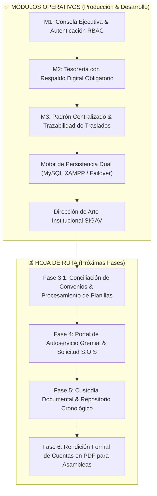

# SIGAV — Sistema Integrado de Gestión Administrativa y Financiera

### Asociación Gremial de Trabajadores de Jardines Infantiles VTF — Temuco

[](#5-guía-de-puesta-en-marcha-entorno-local)
[](#4-arquitectura-del-sistema)
[](#4-arquitectura-del-sistema)
[](#53-persistencia-de-datos)
[](#1-resumen-ejecutivo)
[](#54-verificación-automatizada-del-sistema)

Plataforma web institucional concebida para la gobernanza corporativa, fiscalización contable, administración del padrón gremial, custodia documental y rendición periódica de cuentas de los establecimientos de Educación Parvularia Vía Transferencia de Fondos (VTF) de la comuna de Temuco.

---

## 1. Resumen Ejecutivo

El **Sistema Integrado de Gestión Administrativa y Financiera (SIGAV)** unifica los procesos operativos, estatutarios y de bienestar de la organización gremial, asegurando un registro fidedigno, trazable e inmutable de los recursos sociales:

* **Alcance Gremial:** Cobertura de 23 establecimientos educativos distribuidos en Temuco y Labranza.
* **Padrón Representado:** Centralización de 280 trabajadoras afiliadas (Directoras, Educadoras de Párvulos y Técnicos en Educación Parvularia).
* **Régimen Estatutario de Cuota Social:** Valor unificado de $4.000 CLP mensuales por afiliada activa, distribuido normativamente en tres fondos autónomos:
  * **$1.000 CLP:** Aporte gremial a la Federación Nacional.
  * **$1.000 CLP:** Fondo operacional y corriente de la Asociación Local.
  * **$2.000 CLP:** Fondo de Bienestar y Evento Anual de Socias.

---

## 2. Marco de Gobernanza, Roles y Privacidad

El sistema opera bajo el principio de **mínimo privilegio (PoLP)** y estricta **segregación de funciones**, garantizando la confidencialidad de la información financiera y de convenios conforme a las normativas vigentes de protección de datos personales:

| Nivel de Acceso | Cargo / Unidad Funcional | Alcance Operativo | Perfil Financiero | Canal Institucional |
| :--- | :--- | :--- | :--- | :--- |
| **Administración Técnica** | Administrador de Plataforma | Mantenimiento de infraestructura, seguridad, bitácora y base de datos | Auditoría global y supervisión técnica | `admin@asociacionvtf.cl` |
| **Tesorería General** | Tesorera Titular | Registro de ingresos, emisión de egresos, conciliación y comprobantes | Ejecución y control contable total | `tesoreria@asociacionvtf.cl` |
| **Presidencia Gremial** | Presidenta de la Asociación | Supervisión ejecutiva y representación institucional | **Supervisión (Solo Lectura)**; sin edición de egresos | `presidenta@asociacionvtf.cl` |
| **Secretaría General** | Secretaria de la Directiva | Administración del Padrón (incorporaciones, bajas, traslados) | Sin acceso a finanzas operativas | `secretaria@asociacionvtf.cl` |
| **Dirección de Bienestar** | Directora de Convenios | Fiscalización y enlace con entidades de crédito social | Consolidado general de convenios | `directora@asociacionvtf.cl` |
| **Delegadas de Base** | Representantes de Jardín (23) | Fiscalización de su establecimiento ante la asamblea | **Transparencia Institucional** (sin acceso a deudas individuales) | `delegada@asociacionvtf.cl` |
| **Portal de Afiliadas** | Funcionarias Sindicalizadas | Buzón de consultas/denuncias, solicitudes S.O.S y noticias | Ficha personal e historial individual | *Acceso individual por RUT* |

> **Aviso de Confidencialidad y Seguridad:**
> Toda autenticación requiere cifrado simétrico mediante tokens criptográficos JWT y hashes bcrypt de alta seguridad. Los datos de prueba locales se administran exclusivamente mediante variables de entorno en el servidor (`.env`), protegiendo cualquier dato sensible fuera del código fuente público.

---

## 3. Estado del Proyecto: Módulos Operativos y Hoja de Ruta



### 3.1. Módulos Operativos (Entregados y Verificados)

* **Dirección de Arte Corporativa SIGAV:**
  * Sistema visual unificado con paleta cromática de alta fidelidad: morado heráldico (`#725682`), rosa corporativo, fondos beige cálidos y superficies neutras.
  * Modo nocturno/diurno calibrado con tokens HSL y persistencia en cliente.
  * Menú de navegación lateral institucional, depurado y 100% responsivo para cualquier dispositivo.
* **Consola Ejecutiva y Autenticación Centralizada (V1):**
  * Control de acceso multifactorial por identificador o correo institucional con validación de RUT.
  * Indicadores de alto nivel (KPIs): Socias Activas, Suspendidas y Balance Consolidado de Fondos.
  * Visualización analítica de recaudación interanual (2025/2026) y distribución de fondos gremiales.
* **Tesorería y Control Financiero (V2):**
  * Segregación en cuatro Centros de Costo: `ASOCIACION`, `CENA ANUAL`, `FEDERACION` e `ISI MUNDO COMISION`.
  * **Protocolo de Respaldo Digital Obligatorio:** Ningún egreso contable puede ser procesado sin la incorporación física de un comprobante válido (PDF, JPG, PNG o WEBP).
  * Almacenamiento seguro en servidor con enlace directo para descarga y auditoría forense.
  * Exportación de libros contables a planillas normalizadas (.CSV / Excel).
* **Padrón Centralizado de Afiliadas (V3 Base):**
  * Registro integral de 280 trabajadoras con motor de búsqueda y filtros multidimensionales.
  * Automatización estatutaria: las afiliadas con estado `SUSPENDIDA` quedan exentas de cobro mensual ($0 CLP).
  * Registro y control histórico de traslados inter-jardines con justificación obligatoria.
* **Persistencia Dual y Estabilidad Autónoma:**
  * Integración con base de datos relacional MySQL / MariaDB (XAMPP).
  * Mecanismo de contingencia autónomo en memoria que asegura disponibilidad 24/7 incluso ante caídas del motor de base de datos.
  * Validación integral con 75 pruebas automatizadas aprobadas.

---

### 3.2. Hoja de Ruta (Módulos Planificados)

* **Fase 3.1 — Conciliación de Convenios y Procesamiento de Planillas:**
  * Cuadro de mandos para entidades en convenio: `S.O.S`, `ISIMUNDO`, `OPTICA` y `DENTAL`.
  * Procesador inteligente de planillas de descuento en formato Microsoft Excel (.XLSX) mediante SheetJS.
  * Protocolo de control mensual que exige la verificación de 4 comprobantes bancarios previos a la amortización de cuotas.
* **Fase 4 — Portal de Autoservicio Gremial y Buzón Interactivo:**
  * Acceso diferenciado de funcionarias para revisión personal de aportes y beneficios.
  * Panel de presentación institucional de la Directiva Ejecutiva.
  * Buzón gremial estructurado (Consultas, Sugerencias, Reclamos, Felicitaciones, Denuncias) con soporte de adjuntos.
  * Tramitación en línea de solicitudes de auxilio crediticio de emergencia S.O.S.
* **Fase 5 — Custodia Documental Centralizada:**
  * Repositorio de Instrumentos Legales y Pagarés Maestros descargables.
  * Estructuración cronológica de archivos digitales clasificados por empresa proveedora (`año / mes / día`).
* **Fase 6 — Rendición Formal de Cuentas y Portal de Delegadas:**
  * Consola de transparencia y fiscalización para delegadas gremiales de cada jardín.
  * Generador de informes oficiales de Balance Anual en formato PDF formal para presentación ante asamblea.

---

## 4. Arquitectura del Sistema

```text
dashboard/
├── backend/
│   ├── src/
│   │   ├── config/          # Configuración de entorno y pool MySQL
│   │   ├── controllers/     # Controladores REST desacoplados
│   │   ├── middlewares/     # Seguridad JWT, RBAC, auditoría y carga Multer
│   │   ├── routes/          # Rutas expuestas por la API RESTful
│   │   ├── services/        # Lógica de dominio de tesorería, socias y autenticación
│   │   ├── utils/           # Módulo de validación de cédulas de identidad (Módulo 11)
│   │   ├── validators/      # Esquemas de integridad de datos (Zod)
│   │   └── server.js        # Punto de entrada HTTP y configuración de Express
│   ├── database/            # Scripts DDL y DML para aprovisionamiento relacional
│   ├── test/                # Suites de verificación y pruebas automatizadas
│   └── uploads/             # Bóveda de almacenamiento de comprobantes digitales
├── frontend/
│   ├── src/
│   │   ├── components/      # Librería de componentes visuales institucionales
│   │   ├── context/         # Estados globales de autenticación, permisos y tema
│   │   ├── pages/           # Vistas corporativas (Inicio, Tesorería, Socias)
│   │   ├── routes/          # Enrutamiento protegido por credenciales y roles
│   │   ├── services/        # Adaptadores de comunicación con la API
│   │   └── styles/          # Tokens HSL y hoja de estilos institucionales SIGAV
│   ├── public/              # Isotipo y activos públicos oficiales
│   └── vite.config.js       # Configuración del empaquetador Vite
└── README.md                # Documentación institucional y técnica
```

---

## 5. Guía de Puesta en Marcha (Entorno Local)

### 5.1. Requisitos Técnicos
* Entorno de ejecución **Node.js LTS** (versión 18 o superior).
* Gestor de paquetes **npm**.
* Dos consolas de comandos simultáneas (PowerShell / Terminal).

### 5.2. Despliegue de Servicios Concurrentes

**Consola 1 — Servicio Backend (API):**
```powershell
npm run dev:backend
```
*Disponible en:* `http://localhost:4000/api`

**Consola 2 — Interfaz de Usuario (Frontend):**
```powershell
npm run dev:frontend
```
*Disponible en:* `http://localhost:5173`

### 5.3. Persistencia de Datos
* **MySQL / XAMPP (requerido):** el padrón de socias y el portal de socias trabajan solo con MySQL. Inicie MySQL en el puerto `3306`, cree la base `jardines_vtf` e importe, en este orden:
  1. `database/database.sql` (Esquema DDL relacional).
  2. `database/data.sql` (23 jardines, padrón de 277 socias, convenios y créditos).
  3. `database/admin.sql` (Cuentas de directiva, con cambio de clave obligatorio al primer ingreso).
* **Base ya instalada:** aplique los scripts de `database/migraciones/` en orden de fecha (ver `docs/GUIA_DESPLIEGUE_CPANEL.md`).
* **Sin MySQL (solo desarrollo):** el login de directiva y Tesorería responden con datos de prueba en memoria; en producción la API responde 503.

### 5.4. Verificación Automatizada del Sistema

Requiere MySQL encendido. El ejecutor crea desde cero la base `jardines_vtf_test` con los scripts de `database/` y corre las 7 suites contra ella (nunca toca `jardines_vtf`):

```powershell
npm run test:backend
```

Para verificar la optimización y empaquetado de producción de la interfaz:

```powershell
npm run build:frontend
```

---

## 6. Confidencialidad y Propiedad Intelectual

> **DOCUMENTO CONFIDENCIAL**  
> Este software y su documentación técnica son propiedad exclusiva de la **Asociación de Jardines Infantiles VTF Temuco**. Queda prohibida su reproducción, distribución pública o divulgación de los datos personales contenidos en el padrón o libros contables sin la autorización expresa de la Directiva Sindical conforme a la Ley N° 19.628 sobre Protección de la Vida Privada.
