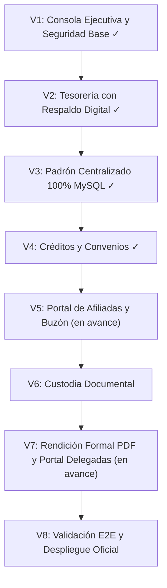

# SIGAV — Sistema Integrado de Gestión Administrativa y Financiera

### Asociación Gremial de Trabajadores de Jardines Infantiles VTF — Temuco

[](#5-guía-de-puesta-en-marcha-entorno-local)
[](#4-arquitectura-del-sistema)
[](#4-arquitectura-del-sistema)
[](#53-persistencia-de-datos)
[](#3-estado-del-proyecto-versiones-y-hoja-de-ruta)
[](#54-verificación-automatizada-del-sistema)

Plataforma web institucional concebida para la gobernanza corporativa, fiscalización contable, administración del padrón gremial, custodia documental y rendición periódica de cuentas de los establecimientos de Educación Parvularia Vía Transferencia de Fondos (VTF) de la comuna de Temuco.

**Producción:** [vtftemuco.cl](https://vtftemuco.cl) (cPanel, una sola aplicación Node que sirve la interfaz y la API).

---

## 1. Resumen Ejecutivo

El **Sistema Integrado de Gestión Administrativa y Financiera (SIGAV)** unifica los procesos operativos, estatutarios y de bienestar de la organización gremial, asegurando un registro fidedigno, trazable e inmutable de los recursos sociales:

* **Alcance Gremial:** Cobertura de 23 establecimientos educativos distribuidos en Temuco y Labranza.
* **Padrón Representado:** 277 trabajadoras afiliadas reales (Directoras, Educadoras de Párvulos, Técnicos, Asistentes y Auxiliares), administradas 100% en MySQL.
* **Régimen Estatutario de Cuota Social:** Valor unificado de $4.000 CLP mensuales por afiliada activa, distribuido normativamente en tres fondos autónomos:
  * **$1.000 CLP:** Aporte gremial a la Federación Nacional.
  * **$1.000 CLP:** Fondo operacional y corriente de la Asociación Local.
  * **$2.000 CLP:** Fondo de Bienestar y Evento Anual de Socias.

---

## 2. Marco de Gobernanza, Roles y Privacidad

El sistema opera bajo el principio de **mínimo privilegio (PoLP)** y estricta **segregación de funciones**, garantizando la confidencialidad de la información financiera y de convenios conforme a las normativas vigentes de protección de datos personales:

| Nivel de Acceso | Cargo / Unidad Funcional | Alcance Operativo | Perfil Financiero | Canal Institucional |
| :--- | :--- | :--- | :--- | :--- |
| **Administración Técnica** | Administrador de Plataforma | Mantenimiento de infraestructura, seguridad, bitácora y base de datos | Auditoría global y supervisión técnica | `admin@vtftemuco.cl` |
| **Tesorería General** | Tesorera Titular | Registro de ingresos, emisión de egresos, conciliación y comprobantes | Ejecución y control contable total | `tesorera@vtftemuco.cl` |
| **Presidencia Gremial** | Presidenta de la Asociación | Supervisión ejecutiva, representación institucional, noticias y buzón de socias | **Supervisión (Solo Lectura)**; sin edición de egresos | `presidenta@vtftemuco.cl` |
| **Secretaría General** | Secretaria de la Directiva | Padrón (incorporaciones, retiros, traslados, planilla y restablecer clave del portal), noticias, buzón e informe mensual | Sin acceso a finanzas: no ve Tesorería, pagos a la Federación, alertas ni recaudación; solo la ficha socia, sin créditos | `secretaria@vtftemuco.cl` |
| **Dirección de Bienestar** | Directora | Mismos permisos que la Secretaria (desde el 16-11-2026) | Sin acceso a finanzas ni a datos de créditos (se redefine en V4) | `directora@vtftemuco.cl` |
| **Delegadas de Base** | Representantes de Jardín (23) | Fiscalización de su establecimiento ante la asamblea | **Informe mensual en solo lectura** con exportación a Excel (sin acceso a deudas individuales) | `delegada@vtftemuco.cl` |
| **Portal de Afiliadas** | Funcionarias Sindicalizadas | Buzón de consultas, reclamos y sugerencias, y noticias | Ficha personal e historial individual | *Acceso individual por RUT* |

> **Acceso y seguridad:**
> - **Ingreso de la directiva:** solo con su RUT y contraseña. Debe cambiar la clave en el primer ingreso.
> - **Ingreso de las socias:** con su RUT, y la clave inicial son los 6 primeros dígitos del RUT. Si la olvidan, la directiva la restablece desde la ficha de la socia.
> - **Sesiones:** se cierran tras 10 minutos de inactividad. El servidor invalida el token al cerrar sesión o al cambiar la contraseña.
> - **Claves y configuración:** las claves se guardan con bcrypt. La aplicación no arranca sin un `JWT_SECRET` propio de 32 caracteres o más, y en producción exige `CORS_ORIGIN`. Los datos sensibles van en variables de entorno (`.env`), nunca en el código fuente.

---

## 3. Estado del Proyecto: Versiones y Hoja de Ruta

El proyecto avanza por versiones según [`docs/PLAN_IMPLEMENTACION.md`](docs/PLAN_IMPLEMENTACION.md). Cada versión tiene un **prototipo** y una **remediación** (versión definitiva, persistente en MySQL y con pruebas automatizadas).



| Versión | Módulo | Estado |
| :---: | :--- | :--- |
| **V1** | Consola Ejecutiva, Directiva y Seguridad Base (PoLP) | Terminado ✓ |
| **V2** | Tesorería Robusta y Respaldo Digital Obligatorio | Terminado ✓ |
| **V3** | Padrón Centralizado 100% Persistente en MySQL | Terminado ✓ — con ajustes de la directiva y cierre de la auditoría de seguridad (17/11/2026) |
| **V4** | Módulo Independiente de Créditos y Convenios | Terminado ✓ (18/11/2026) |
| **V5** | Portal de Afiliadas, Primer Ingreso y Buzón Gremial | En avance: comunicaciones de la directiva, recuperación de clave y solicitudes S.O.S hechas; falta la revisión final del portal |
| **V6** | Custodia Documental y Carpeta por Proveedor | Pendiente |
| **V7** | Rendición Formal de Cuentas (PDF) y Portal Delegadas | En avance: informe mensual con Excel hecho; falta el Balance Anual en PDF |
| **V8** | Validación Integral E2E y Despliegue Oficial en cPanel | Pendiente |

### 3.1. Módulos Operativos (Entregados y Verificados)

* **Dirección de Arte Corporativa SIGAV:**
  * Sistema visual unificado: morado heráldico (`#725682`), rosa corporativo, fondos beige cálidos y superficies neutras.
  * Modo nocturno/diurno calibrado con tokens HSL y persistencia en cliente.
  * Menú de navegación lateral institucional, 100% responsivo.
* **V1 — Consola Ejecutiva y Autenticación:**
  * Ingreso solo con RUT, botón para ver u ocultar la contraseña y cambio de clave obligatorio en el primer ingreso.
  * Cierre de sesión por 10 minutos de inactividad, y sesiones que el servidor invalida al cerrar sesión o cambiar la clave.
  * Indicadores calculados con datos reales: socias activas, créditos por convenio, alertas de última cuota, gráfico mensual de ingresos y egresos, y estado del pago a la Federación.
  * Secciones financieras del Inicio ocultas para Secretaria, Directora, Delegadas y Socias.
* **V2 — Tesorería y Control Financiero:**
  * Cuatro Centros de Costo: `ASOCIACION`, `CENA ANUAL`, `FEDERACION` e `ISI MUNDO COMISION`.
  * **Respaldo Digital Obligatorio:** ningún egreso se registra sin comprobante (PDF, JPG, PNG o WEBP), con su metadata guardada en MySQL.
  * Saldos calculados desde los asientos oficiales de apertura (`SALDO_APERTURA`) y correlativos atómicos.
  * Exportación del libro contable a CSV protegido contra fórmulas de Excel.
  * **Corrección de movimientos** (Tesorera y Admin): **Editar** fecha, monto, descripción, método, categoría o comprobante, y **Anular** con motivo. El anulado queda en el libro, tachado, y deja de sumar en saldos, Inicio e informe mensual; la auditoría guarda el antes y el después.
* **V3 — Padrón Centralizado de Afiliadas:**
  * 277 socias reales en 23 jardines, con búsqueda por nombre, RUT, jardín o correo y paginación en el servidor.
  * Retiro como baja lógica (`RETIRADA`) con motivo y fecha; se reactiva editando el estado y conserva créditos e historial.
  * Traslados entre jardines en transacción, con motivo obligatorio e historial.
  * Carga de la planilla **"Maestra Socias"** (Excel) con vista previa y aplicación en una sola transacción.
  * Exportación del padrón según el filtro aplicado.
  * Ficha socia y ficha crédito separadas: los créditos solo los ven Admin, Presidenta y Tesorera.
  * Botón "Restablecer clave" en la ficha de la socia para recuperar su acceso al portal.
  * **Resumen de créditos en PDF** de cada socia (empresa, monto y cuotas), desde el padrón o su ficha de crédito.
* **V4 — Créditos y Convenios:**
  * Cinco empresas: S.O.S, ISIMUNDO, Óptica, Dental y Abogada, cada una con su tarjeta "A pagar" y "Último pago".
  * Carga de la planilla **"Maestra Créditos"** el día 18, con vista previa y aplicación en una sola transacción.
  * Verificación de pagos entre el 1 y el 5 con un comprobante por empresa, guardado por mes y empresa sin sobrescribirse.
  * Historial con búsqueda, filtros y ficha de cada crédito, y gráfico de créditos vigentes y en última cuota.
  * Ingreso a mano sin Excel: **Nuevo crédito** (socia, empresa, valor cuota, cuotas, mes de la primera cuota y cuotas ya pagadas) y, desde la ficha, **Editar**, **Registrar prepago** y **Anular** con motivo.
  * **Monto "A pagar" a mano** para los meses sin planilla, o para corregir el de la planilla antes de verificar el pago.
  * **Comisión de Isi Mundo con % ajustable** (2 % por defecto): se calcula al verificar el pago de ISIMUNDO y se registra con un botón como ingreso en Tesorería.
  * **Liquidación para el empleador:** por mes, Excel con una fila por socia (cuota social y cuota de cada convenio) y hoja de resumen por empresa.
  * Estados por color: Vigente, **Quedan 2 cuotas** (naranjo), **Última cuota** (rojo suave) y Pagado (verde).
  * Ven la sección Admin, Presidenta (solo lectura) y Tesorera; cargan, verifican e ingresan créditos Admin y Tesorera.
* **Comunicaciones (adelanto de V5):** la directiva publica y elimina noticias, lee el buzón de las socias, marca los mensajes como leídos o respondidos y descarga los adjuntos.
* **S.O.S en línea (V5):** la socia pide su crédito de emergencia desde el portal (monto, 1 a 4 cuotas y motivo) y ve la respuesta. Admin y Tesorera lo aprueban desde Créditos, lo que crea su crédito S.O.S, o lo rechazan con motivo.
* **Informe mensual (adelanto de V7):** pago a la Federación, total de egresos, total disponible y cantidad de movimientos, con exportación a Excel. Las delegadas lo ven en modo solo lectura.
* **Seguridad (auditoría de 27 hallazgos, 17/11/2026):**
  * Validación con zod en todos los endpoints y login sin enumeración de cuentas.
  * Protección contra planillas Excel maliciosas y tope de montos.
  * Respaldo de la auditoría en archivo si MySQL falla.
  * Pruebas de la matriz de accesos por rol.
* **Persistencia y estabilidad:**
  * Base de datos MySQL / MariaDB como única fuente de datos. En producción, si MySQL no está disponible la API responde **503** en vez de mostrar datos de prueba, y `/api/health` informa el estado de la conexión.
  * Fechas registradas en hora de Chile (`America/Santiago`).

### 3.2. Hoja de Ruta (Próximas Versiones)

* **V5 — Portal de Afiliadas:** revisión final del portal. Las solicitudes S.O.S en línea, la gestión del buzón, la descarga de adjuntos, el límite de intentos y la recuperación de clave ya están hechos.
* **V6 — Custodia Documental:** repositorio de instrumentos legales y pagarés, ordenado por empresa proveedora (`año / mes / día`).
* **V7 — Rendición Formal de Cuentas:** Balance Anual en PDF para la asamblea y cifras por jardín para las delegadas. El informe mensual ya está hecho.
* **V8 — Validación E2E y Despliegue Oficial:**
  * Pruebas de extremo a extremo.
  * Actualización mayor de dependencias (`uuid`, `react-router`, `zod` del frontend).
  * Cierre por inactividad también en el servidor.
  * Hallazgos de la auditoría que se revisan en cPanel.

---

## 4. Arquitectura del Sistema

```text
dashboard/
├── backend/
│   ├── src/
│   │   ├── config/          # Variables de entorno y pool MySQL
│   │   ├── controllers/     # Controladores REST
│   │   ├── middlewares/     # JWT, RBAC, auditoría y carga de archivos (Multer)
│   │   ├── routes/          # Rutas de la API REST
│   │   ├── services/        # Lógica de tesorería, socias, padrón, portal y autenticación
│   │   ├── utils/           # RUT (Módulo 11), formato de socias y fechas en hora de Chile
│   │   ├── validators/      # Esquemas de validación (Zod)
│   │   └── server.js        # Configuración de Express
│   ├── app.cjs              # Punto de entrada para cPanel (Passenger)
│   ├── test/                # Suites de pruebas automatizadas (9)
│   └── uploads/             # Comprobantes y planillas cargadas
├── database/
│   ├── database.sql         # Esquema relacional
│   ├── data.sql             # Jardines, padrón, convenios, créditos y saldos de apertura
│   ├── admin.sql            # Cuentas de la directiva
│   └── migraciones/         # Cambios para bases ya instaladas
├── docs/
│   ├── PLAN_IMPLEMENTACION.md     # Plan maestro por versiones
│   ├── GUIA_DESPLIEGUE_CPANEL.md  # Instalación desde cero en cPanel
│   └── TEMA_SIGAV.md              # Sistema de diseño
├── frontend/
│   ├── src/
│   │   ├── components/      # Componentes visuales institucionales
│   │   ├── context/         # Autenticación, permisos y tema
│   │   ├── pages/           # Inicio, Tesorería, Socias, Créditos, Comunicaciones, Reportes y Portal de Socias
│   │   ├── routes/          # Rutas protegidas por rol
│   │   ├── services/        # Cliente de la API
│   │   └── styles/          # Tokens HSL y estilos SIGAV
│   ├── public/              # Isotipo y activos públicos
│   └── vite.config.js       # Configuración de Vite
└── README.md
```

---

## 5. Guía de Puesta en Marcha (Entorno Local)

### 5.1. Requisitos Técnicos
* **Node.js** 20 o superior y **npm**.
* **MySQL / MariaDB** (por ejemplo, XAMPP) en el puerto `3306`.
* Dos consolas de comandos (PowerShell / Terminal).

### 5.2. Despliegue de Servicios Concurrentes

**Consola 1 — Servicio Backend (API):**
```powershell
npm run dev:backend
```
*Disponible en:* `http://localhost:4000/api`

**Consola 2 — Interfaz de Usuario (Frontend):**
```powershell
npm run dev:frontend
```
*Disponible en:* `http://localhost:5173`

### 5.3. Persistencia de Datos
* **MySQL (requerido):** cree la base `jardines_vtf` e importe, en este orden:
  1. `database/database.sql` (esquema relacional).
  2. `database/data.sql` (23 jardines, padrón de 277 socias, convenios, créditos y los 2 saldos de apertura oficiales de 2026).
  3. `database/admin.sql` (cuentas de la directiva, con cambio de clave obligatorio al primer ingreso).
* **Base ya instalada:** aplique los scripts de `database/migraciones/` en orden de fecha.
* **Sin MySQL (solo desarrollo y pruebas):** el login de directiva y Tesorería responden con datos de prueba en memoria. En producción esto está desactivado y la API responde 503.

### 5.4. Verificación Automatizada del Sistema

Requiere MySQL encendido. El ejecutor crea desde cero la base `jardines_vtf_test` con los scripts de `database/` y corre las 10 suites (160 pruebas) contra ella; nunca toca `jardines_vtf`:

```powershell
npm run test:backend
```

Para verificar el empaquetado de producción de la interfaz:

```powershell
npm run build:frontend
```

### 5.5. Despliegue en Producción

La instalación en cPanel (`vtftemuco.cl`) se describe paso a paso en [`docs/GUIA_DESPLIEGUE_CPANEL.md`](docs/GUIA_DESPLIEGUE_CPANEL.md): paquete de producción, base con prefijo `vtftemuc_`, aplicación Node con `app.cjs`, variables de entorno (`JWT_SECRET` y `CORS_ORIGIN=https://vtftemuco.cl` son obligatorias) y verificación con `/api/health`.

---

## 6. Confidencialidad y Propiedad Intelectual

> **DOCUMENTO CONFIDENCIAL**  
> Este software y su documentación técnica son propiedad exclusiva de la **Asociación de Jardines Infantiles VTF Temuco**. Queda prohibida su reproducción, distribución pública o divulgación de los datos personales contenidos en el padrón o libros contables sin la autorización expresa de la Directiva Sindical conforme a la Ley N° 19.628 sobre Protección de la Vida Privada.
