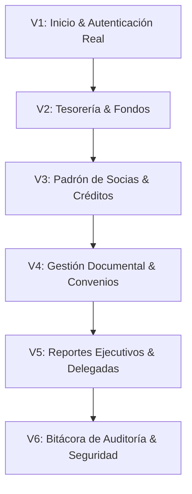

# Sistema Web de Gestión — Asociación VTF Temuco

Sistema web institucional responsive para la gestión administrativa, contable, financiera y de transparencia de la **Asociación de Jardines VTF Temuco** (Vía Transferencia de Fondos).

**Versión definitiva:** Unificación consolidada de `develop-deus` (Frontend SIGAV & Padrón V3) y `feat/mysql-xampp` (MySQL XAMPP & BD 277 socias) · [Instalación y ejecución completa](#5-ejecución-local-completa) · [Tema visual SIGAV](docs/TEMA_SIGAV.md)

---

## 1. Contexto Institucional

La Asociación cuenta con:
- **280 socias activas y suspendidas** (Directoras, Educadoras y Técnicos en Educación Parvularia).
- **23 jardines infantiles** distribuidos en la comuna de Temuco.
- **23 delegadas** (una representante electa por cada establecimiento educativo).
- **Directiva Oficial:** Presidenta, Tesorera, Secretaria y Directora.
- **Cuota Social Mensual:** $4.000 CLP fijos con distribución tripartita estatutaria ($1.000 Federación Nacional, $1.000 Asociación, $2.000 Fondo Cena Anual).

---

## 2. Matriz Oficial de Roles y Permisos

| Rol | Titular Oficial | Identificador / RUT | Permisos Operativos | Visibilidad Financiera |
| :--- | :--- | :--- | :--- | :--- |
| **Super Admin** | Jhonny Marcelo Ferrada Pasten | `17.260.651-2` | Administración global del sistema, roles y base de datos | Acceso y modificación total |
| **Tesorera** | Alejandra Romanett Sias Novoa | `13.918.472-6` | Modificación de todo el sistema y dueña exclusiva del módulo Tesorería | Acceso financiero completo y registro de movimientos |
| **Presidenta** | Yerthie Johanna Sayago Gajardo | `15.421.368-7` | Supervisión general y modificación en toda la app | **Solo Lectura en Tesorería** (supervisión sin edición de gastos) |
| **Secretaria** | Nelly Ester Mella Burgos | `14.832.195-4` | Solo ver general, pero **puede agregar y modificar Socias** | Sin acceso a finanzas operativas |
| **Directora** | Victoria Catalina Abarza Vega | `16.274.593-8` | Solo ver general, con excepción en gestión de Convenios/Créditos | Resumen general autorizado |
| **Delegadas** | Representantes de Jardín (Ej: Claudia Navarro) | `17.890.123-1` | Representación de su establecimiento ante la asamblea | **Exclusivo módulo de Reportes** (prohibido ver deudas privadas) |

> **Nota:** La contraseña unificada de prueba para todas las cuentas de demostración es: `Admin123!`

---

## 3. Hoja de Ruta Segmentada por Versiones

El desarrollo del sistema está estructurado en versiones incrementales y especializadas:



### ✅ V1 — Inicio Institucional y Autenticación Real [COMPLETADA]
- **Identidad Oficial:** Integración del logo oficial de la Asociación VTF Temuco y tema visual SIGAV (morado #725682, palo rosa, fondo beige cálido y superficies blancas).
- **Autenticación RBAC:** Soporte de acceso mediante **RUT chileno** (módulo 11) o correo institucional, con perfiles reales precargados.
- **Navbar Institucional:** Buscador global (*"Buscar en sistema..."*) y tarjeta de perfil activo con avatar, cargo y rol.
- **Dashboard de Inicio:**
  * **3 Recuadros KPI Superiores:** Socias Activas (276), Socias Suspendidas (4) y Saldo Total ($14.580.000 desglosado en Cena Anual $9.260.000 + Asociación $5.320.000).
  * **3 Recuadros Medianos:** Correlativo de los últimos 5 pagos a federación con comprobante respaldado, Próximas Tareas de tesorería y Alertas inteligentes (socias con última cuota y estado de aporte federación al día).
  * **2 Gráficos Analíticos:** Gráfico de Recaudación Mensual con selector interactivo de año (2026/2025) y Gráfico de Estado de Socias con créditos vigentes.

### ✅ V2 — Módulo Completo de Tesorería [COMPLETADA]
- **Centros de Costo Oficiales:**
  * `ASOCIACION`: Cuotas sociales ordinarias y gastos operativos/bienestar.
  * `CENA ANUAL`: Ahorro para el evento anual y préstamos de emergencia S.O.S.
  * `FEDERACION`: Exclusivo para registrar egresos/pagos del aporte nacional.
  * `ISI MUNDO COMISION`: Ingresos generados por el 2% de retorno de convenios.
- **7 Recuadros de Información Visible:** Total Ingresos, Total Egresos, Saldo Total (`Asociación + Cena Anual`), Total Movimientos, Pagos a Federación, Saldo Asociación y Saldo Cena Anual.
- **Regla Estricta de Egresos:** Prohibición absoluta de registrar egresos sin comprobante obligatorio adjunto.
- **Subida Real de Comprobantes:** Todo egreso exige adjuntar el archivo de respaldo (PDF, JPG, PNG o WEBP, máx. 5 MB). El archivo se guarda en `backend/uploads/` con nombre aleatorio y se visualiza desde la tabla con el botón *Ver* (cada descarga queda en auditoría). Los movimientos históricos se muestran como *Respaldo físico*.
- **Modal de Nuevo Movimiento:** Pestañas transaccionales diferenciadas para *Ingreso*, *Egreso* y *Pago Federación* con responsable automático de sesión.
- **Permisos Específicos:** Vista de *Solo Lectura* automática para la Presidenta y modo operativo de registro para la Tesorera y el Admin.
- **Filtros y Exportación:** Filtrado por tipo, centro de costo, método y fechas, con exportación completa a formato `.csv` compatible con Excel.

### ✅ V3 — Padrón de Socias y Gestión de Créditos [COMPLETADA — pendiente carga Excel]
- **Padrón de 280 socias** (276 activas + 4 suspendidas) con búsqueda por nombre o RUT y filtros por jardín, estado, cargo y crédito; paginación y exportación a `.csv`.
- **Cuota social:** $4.000 CLP para socias activas; las suspendidas se muestran *Sin cobro* (bloqueo de cobro indebido).
- **Columna CRÉDITO (SI / NO):** abre la ficha con los créditos vigentes y finalizados (`ISIMUNDO`, `S.O.S`, `OPTICA`, `DENTAL`), cuotas pagadas (ej: 3/6), valor cuota, saldo pendiente y comisión 2% Isi Mundo.
- **Alta y edición de socias** con validación de RUT (módulo 11) y RUT único. Permitido a Admin, Presidenta, Tesorera y Secretaria; la Directora consulta en modo lectura.
- **Traslados de jardín** con motivo obligatorio e historial; la delegada trasladada deja de representar a su jardín anterior.
- **Catálogo de los 23 jardines** con socias activas y delegada electa.
- Cada alta, edición y traslado queda en la bitácora de auditoría.
- Opera en memoria igual que Tesorería, a la espera de la conexión con PostgreSQL.
- ⏳ Pendiente: procesamiento y validación masiva de planillas Excel mensuales con SheetJS.

### ⏳ V4 — Gestión Documental y Subida Móvil
- **3 Subsecciones Documentales:**
  * *Documentos Maestros:* 4 contratos marco descargables para convenios.
  * *Carpetas por Empresa:* `ISIMUNDO`, `OPTICA`, `DENTAL`, `GIMNASIO` organizadas cronológicamente por año/mes/día con correlativo formal.
- Flujo de solicitud, firma y digitalización de pagarés y autorizaciones.
- Conexión PWA ligera para captura y subida rápida de comprobantes fotográficos desde el celular.

### ⏳ V5 — Reportes Ejecutivos y Portal Delegadas
- Vista dedicada y protegida exclusivamente para las **23 Delegadas** de jardín:
  * Monto total pagado a Federación.
  * Saldo consolidado Asociación + Cena Anual.
  * Socias activas por jardín.
  * **Protección estricta de privacidad:** Sin acceso a deudas individuales ni datos confidenciales de otras socias.
- Generación de informe oficial de **Rendición Anual de Cuentas** en PDF formal para asamblea.

### ⏳ V6 — Bitácora de Auditoría y Seguridad
- Trazabilidad forense inmutable de todas las acciones realizadas en la plataforma (inicios de sesión, creación de movimientos contables, cambios en socias y exportaciones).
- Metadatos con dirección IP, usuario, timestamp y detalle de cambios para respaldo legal.

---

## 4. Estructura del Proyecto

```text
dashboard/
├── backend/
│   ├── src/
│   │   ├── config/          # Variables de entorno y pool MySQL / Prisma
│   │   ├── controllers/     # AuthController, DashboardController, TreasuryController, SociaController
│   │   ├── middlewares/     # authMiddleware, roleMiddleware, errorMiddleware, uploadMiddleware
│   │   ├── routes/          # authRoutes, dashboardRoutes, treasuryRoutes, sociaRoutes, index
│   │   ├── services/        # AuthService, AuditService, DashboardService, TreasuryService, SociaService
│   │   ├── utils/           # rutValidator, helpers
│   │   ├── validators/      # authValidator, treasuryValidator, sociaValidator (Zod)
│   │   └── server.js        # Punto de entrada Express
│   ├── prisma/
│   │   ├── schema.prisma    # Esquema relacional PostgreSQL
│   │   └── seed.js          # Poblado de base de datos
│   ├── test/
│   │   ├── authTest.js      # Pruebas de autenticación y RBAC
│   │   ├── sociasTest.js    # Pruebas de padrón, cuotas y traslados V3
│   │   └── comprobantesTest.js # Pruebas de subida y descarga de comprobantes
│   └── package.json
├── database/                # Scripts SQL para MySQL XAMPP (JARDINES_VTF)
│   ├── database.sql         # Esquema DDL, tablas relacionales, vistas
│   ├── admin.sql            # Directiva y delegadas con roles
│   ├── data.sql             # Padrón continuo de socias (1 al 277) y convenios
│   └── patch_xampp.sql      # Parches de compatibilidad XAMPP
├── frontend/
│   ├── public/
│   │   └── logo-vtf.png     # Logo oficial de la Asociación VTF Temuco
│   ├── src/
│   │   ├── components/      # UI institucional: Button, Input, Card, Badge, Sidebar, Navbar
│   │   ├── context/         # AuthContext (Sesión y roles RBAC), ThemeContext
│   │   ├── pages/           # LoginPage, DashboardPage (V1), TreasuryPage (V2), Placeholders (V3-V6)
│   │   ├── routes/          # AppRoutes, ProtectedRoute
│   │   ├── services/        # Cliente Axios y servicios API (auth, treasury)
│   │   ├── styles/          # index.css (tokens HSL, diseño responsivo, tipografías)
│   │   ├── App.jsx
│   │   └── main.jsx
│   ├── index.html
│   └── package.json
├── AGENTS.md                # Reglas de desarrollo Antigravity
├── .gitignore
├── package.json             # Scripts raíz
└── README.md
```

---

## 5. Ejecución local completa

Este repositorio contiene **dos aplicaciones** que deben estar ejecutándose al mismo tiempo:

| Aplicación | Tecnología | Dirección predeterminada |
| :--- | :--- | :--- |
| Frontend | React + Vite | [http://localhost:5173](http://localhost:5173) |
| Backend / API | Express + Node.js | [http://localhost:4000/api/health](http://localhost:4000/api/health) |
| PostgreSQL | Opcional para la demostración | El host/puerto configurado en `backend/.env` |

### 5.1. Requisitos

- Git.
- Node.js y npm. El arranque y la compilación se comprobaron con Node.js 24; puedes consultar tus versiones con `node --version` y `npm.cmd --version`.
- Dos terminales PowerShell abiertas en la carpeta raíz `dashboard`.
- Internet durante la instalación de dependencias.
- PostgreSQL únicamente si vas a probar la conexión a base de datos de la sección 5.8.

Los ejemplos siguientes usan **PowerShell de Windows**. En Linux/macOS, utiliza `npm` y `npx` en lugar de `npm.cmd` y `npx.cmd`, y adapta los comandos de carpetas.

### 5.2. Descargar la rama correcta

```powershell
git clone --branch develop-deus https://github.com/swix14/dashboard.git
Set-Location dashboard
```

Si ya tienes el repositorio clonado:

```powershell
Set-Location -LiteralPath 'C:\ruta\a\dashboard'
git fetch origin
git switch develop-deus
git pull --ff-only origin develop-deus
```

Sustituye `C:\ruta\a\dashboard` por la carpeta real. Si Git informa cambios locales o ramas divergentes, revísalos antes de actualizar; estos comandos no fuerzan ni descartan trabajo.

### 5.3. Instalar dependencias

Desde la raíz `dashboard`:

```powershell
npm.cmd --prefix backend ci
npm.cmd --prefix frontend ci
```

`ci` utiliza los `package-lock.json` versionados. La raíz solo contiene scripts de coordinación; las dependencias se instalan dentro de `backend` y `frontend`.

### 5.4. Preparar el entorno de demostración

Para abrir las pantallas y probar los flujos actuales puedes utilizar el **modo memoria**, sin instalar PostgreSQL. Crea `backend/.env` con una clave JWT aleatoria; el siguiente comando no sobrescribe un archivo existente ni muestra la clave:

```powershell
if (-not (Test-Path -LiteralPath '.\backend\.env')) {
  node -e "const fs=require('node:fs'); const crypto=require('node:crypto'); const lines=['PORT=4000','NODE_ENV=development','DATABASE_URL=','JWT_SECRET='+crypto.randomBytes(32).toString('hex'),'JWT_EXPIRES_IN=8h','CORS_ORIGIN=http://localhost:5173']; fs.writeFileSync('backend/.env',lines.join('\n')+'\n',{flag:'wx'});"
}
```

Después genera el cliente Prisma, incluso si vas a trabajar en memoria:

```powershell
npm.cmd --prefix backend run prisma:generate
```

Variables utilizadas por el backend:

| Variable | Uso |
| :--- | :--- |
| `PORT` | Puerto de la API; predeterminado `4000` |
| `NODE_ENV` | `development` para ejecución local |
| `DATABASE_URL` | Vacía para la demo en memoria, o conexión PostgreSQL privada |
| `JWT_SECRET` | Secreto aleatorio de firma de sesión; no compartir ni versionar |
| `JWT_EXPIRES_IN` | Vigencia del token; ejemplo `8h` |
| `CORS_ORIGIN` | Origen del frontend, por ejemplo `http://localhost:5173` |
| `UPLOADS_DIR` | Opcional; por defecto `backend/uploads` |

El archivo `backend/.env.example` también muestra las variables disponibles, pero contiene valores de demostración: sustituye sus credenciales y secreto si lo usas como plantilla. `.env` y los archivos subidos están excluidos de Git.

**Alcance del modo memoria:** las cuentas y datos iniciales se cargan desde el código. Las altas, movimientos y cambios guardados en memoria se pierden al reiniciar el backend. Los archivos de comprobantes se guardan en disco, pero sus referencias en memoria pueden perderse al reiniciar. Utiliza datos de prueba.

### 5.5. Iniciar TODO el proyecto

Abre **dos terminales**, ambas en la carpeta raíz `dashboard`.

**Terminal 1 — backend:**

```powershell
npm.cmd run dev:backend
```

Mantén esta terminal abierta. La API debe indicar que escucha en el puerto `4000`; si no hay PostgreSQL disponible, mostrará el mensaje de modo memoria.

**Terminal 2 — frontend:**

```powershell
npm.cmd --prefix frontend run dev -- --host localhost --strictPort
```

`--strictPort` evita que Vite cambie de puerto silenciosamente si el `5173` está ocupado. El parámetro `--host localhost` limita esta vista previa al equipo local.

Abre **[http://localhost:5173](http://localhost:5173)** en el navegador. El frontend utiliza la API `http://localhost:4000/api` de forma predeterminada. El frontend por sí solo puede mostrar el acceso, pero necesita el backend para autenticar y consultar datos.

También existe el script raíz `npm.cmd run dev:frontend`, que utiliza la configuración de host de `frontend/vite.config.js`. Para la vista previa local se recomienda el comando explícito anterior.

### 5.6. Verificar e ingresar

Con ambos servidores iniciados:

```powershell
Invoke-RestMethod -Uri 'http://localhost:4000/api/health'
```

La respuesta debe incluir `status: ok`. Este endpoint confirma que la API responde; **no comprueba la persistencia de los módulos ni la conexión PostgreSQL**.

En la pantalla de acceso puedes seleccionar uno de los perfiles de demostración para completar sus campos y luego pulsar **Ingresar al Sistema**. La clave demo de esta versión es `Admin123!`; las cuentas y sus identificadores están descritos en la sección 2 y en el selector del login.

Estas credenciales corresponden al prototipo de este repositorio. No utilizar sus cuentas de ejemplo ni la contraseña compartida en una instalación institucional.

### 5.7. Detener, reiniciar y seguir desarrollando

- `Ctrl+C` en cada terminal detiene su servidor.
- Para reiniciar, vuelve a ejecutar los dos comandos de la sección 5.5.
- Después de apagar el computador, abre dos terminales en `dashboard` y repite esos comandos. No hace falta instalar dependencias cada vez.
- Los cambios de frontend se reflejan mediante Vite. El backend usa `node --watch`; modificar su código puede reiniciarlo y borrar los cambios que solo existan en memoria.
- Si cambias `JWT_SECRET`, cierra sesión e ingresa nuevamente para renovar el token.

### 5.8. Base de datos MySQL (XAMPP), Persistencia Dual y Contingencia

El sistema implementa una **arquitectura híbrida de persistencia** con detección no bloqueante:

#### A) Modo MySQL con XAMPP (Persistencia real con 277 socias)
1. Inicia **Apache** y **MySQL** desde el panel de control de XAMPP.
2. Abre phpMyAdmin en `http://localhost/phpmyadmin`.
3. Importa los scripts SQL ubicados en la carpeta `database/` en el siguiente orden estricto:
   - `database/database.sql`: Crea la base de datos `JARDINES_VTF`, tablas (`socias`, `administradores`, `convenios`, `creditos`, `cuotas_credito`, `liquidaciones_mensuales`, `movimientos_tesoreria`, `auditoria`) y vistas.
   - `database/admin.sql`: Carga inicial de usuarios de directiva y delegadas con roles estandarizados (`Super_Admin`, `Tesorera`, `Presidenta`, `Secretaria`, `Directora`, `Delegada`).
   - `database/data.sql`: Carga masiva del padrón continuo de **277 socias** consecutivas (ID 1 al 277), convenios y créditos activos.
   - `database/patch_xampp.sql`: Parche opcional de compatibilidad de fechas e índices para XAMPP.
4. Configura las variables en `backend/.env`:
   ```dotenv
   DB_HOST=localhost
   DB_PORT=3306
   DB_USER=root
   DB_PASSWORD=
   DB_NAME=jardines_vtf
   ```
5. Al iniciar el backend, se conectará automáticamente mediante el pool `mysql2/promise` mostrando:
   `✓ Conexión exitosa a MySQL XAMPP: jardines_vtf@localhost:3306`

#### B) Modo Contingencia en Memoria (Zero-Config)
Si no dispones de XAMPP o el servicio MySQL no está iniciado, el backend detecta automáticamente la indisponibilidad de forma no bloqueante y activa el **Modo Contingencia** con los 280 registros semilla en memoria:
`ℹ MySQL XAMPP no disponible. Modo contingencia activo.`
Esto permite probar, auditar y ejecutar la suite de pruebas completa sin requerir un servidor de base de datos levantado.

#### C) Soporte Relacional Prisma / PostgreSQL (Opcional)
Adicionalmente, el proyecto conserva el esquema `backend/prisma/schema.prisma` y sus migraciones para entornos PostgreSQL mediante `DATABASE_URL` y `npx prisma migrate deploy`.

### 5.9. Compilar y previsualizar el frontend

Desde la raíz:

```powershell
npm.cmd run build:frontend
npm.cmd --prefix frontend run preview -- --host localhost --port 4173 --strictPort
```

La compilación queda en `frontend/dist`. La previsualización se abre en [http://localhost:4173](http://localhost:4173) y **sigue necesitando el backend en el puerto 4000**. `vite preview` es una previsualización local, no una configuración de despliegue institucional.

Para ejecutar el backend sin observación de archivos:

```powershell
npm.cmd --prefix backend run start
```

Utiliza `start` en lugar de `dev:backend`, no simultáneamente en el mismo puerto.

### 5.10. Pruebas disponibles

Desde la raíz:

```powershell
npm.cmd run test:backend
```

O por grupo:

```powershell
npm.cmd --prefix backend run test:auth
npm.cmd --prefix backend run test:socias
npm.cmd --prefix backend run test:comprobantes
```

Las pruebas levantan sus propios servidores en puertos efímeros. Ejecútalas con configuración de desarrollo y datos de prueba; el grupo de comprobantes escribe archivos temporales en el directorio de subidas. Estos scripts existen en el repositorio; documentarlos no significa que toda funcionalidad o configuración PostgreSQL esté validada para producción.

### 5.11. Cambiar puertos o URL de la API

- Backend: cambia `PORT` en `backend/.env` y reinicia.
- Frontend: agrega `--port 5174` al comando Vite si necesitas otro puerto.
- Si cambia la dirección de la API, crea `frontend/.env.local`:

```dotenv
VITE_API_URL=http://localhost:4001/api
```

El valor debe incluir `/api`. Reinicia Vite después de editar el archivo. Para generar un build con otra URL, configura esa variable **antes** de compilar: Vite la incorpora durante el build.

### 5.12. Solución de problemas

| Síntoma | Qué revisar |
| :--- | :--- |
| `npm`/`node` no reconocido | Instalar Node.js con npm y reabrir PowerShell para actualizar PATH |
| `npm.ps1` bloqueado | Utilizar `npm.cmd`, sin desactivar políticas del equipo |
| npm instalado fuera del PATH | Sustituir `npm.cmd` por `& 'C:\Program Files\nodejs\npm.cmd'` si esa es tu instalación |
| `EADDRINUSE` o puerto ocupado | Ya hay un servidor en ese puerto; detener solo la instancia propia o configurar otro puerto |
| Pantalla de acceso carga, pero no inicia sesión | Verificar backend `4000/api/health`, URL `VITE_API_URL` y credenciales demo |
| Cliente Prisma no generado | Ejecutar `npm.cmd --prefix backend run prisma:generate` |
| Error de conexión PostgreSQL | Para demo, dejar `DATABASE_URL` vacía; para PostgreSQL, comprobar servicio, usuario, puerto y migraciones |
| Error de permisos en `uploads` | Comprobar permiso de escritura en `backend/uploads` o en `UPLOADS_DIR` |
| Prisma no puede reemplazar su DLL en Windows | Detener el backend que esté utilizando el cliente antes de regenerarlo y luego reiniciar |
| Los cambios de socias o movimientos desaparecen | Revisar si pertenecían al modo memoria; es una limitación actual, no una copia persistida en PostgreSQL |
| Estilo anterior después de actualizar la rama | Actualizar el navegador; los archivos actuales del tema se describen en `docs/TEMA_SIGAV.md` |

### 5.13. Resumen de scripts

| Comando desde `dashboard` | Función |
| :--- | :--- |
| `npm.cmd run dev:backend` | Backend con reinicio automático |
| `npm.cmd run dev:frontend` | Frontend con configuración Vite del repositorio |
| `npm.cmd run build:frontend` | Compilación del frontend |
| `npm.cmd run test:backend` | Grupos de pruebas del backend |
| `npm.cmd --prefix backend run start` | Backend sin `--watch` |
| `npm.cmd --prefix backend run prisma:generate` | Generar cliente Prisma |
| `npm.cmd --prefix backend run prisma:migrate` | Desarrollo de migraciones, mediante `migrate dev` |
| `npm.cmd --prefix backend run prisma:seed` | Sincronizar catálogos iniciales |
| `npm.cmd --prefix frontend run preview` | Previsualizar el frontend compilado |

No existe un script raíz `npm run dev` que arranque ambos servicios. Utiliza las dos terminales de la sección 5.5.

Para consultar los cambios de identidad visual de esta rama: [Tema SIGAV](docs/TEMA_SIGAV.md).
