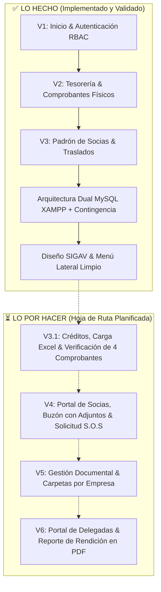

# Sistema Web de Gestión — Asociación VTF Temuco

Sistema web institucional responsive para la administración integral, control financiero, padrón de socias, gestión de convenios y rendición de cuentas de la **Asociación de Jardines VTF Temuco** (Vía Transferencia de Fondos).

**Rama principal de desarrollo:** `develop` · [Instalación y ejecución](#5-ejecución-local-completa) · [Tema visual SIGAV](docs/TEMA_SIGAV.md)

---

## 1. Contexto Institucional

La Asociación representa y administra los fondos y beneficios de:
- **280 socias en padrón** (Directoras, Educadoras y Técnicos en Educación Parvularia).
- **23 jardines infantiles** VTF distribuidos en Temuco y Labranza.
- **23 delegadas sindicales** (una representante electa por cada establecimiento educativo).
- **Directiva Oficial:** Presidenta, Tesorera, Secretaria y Directora.
- **Cuota Social Mensual:** $4.000 CLP fijos con distribución estatutaria tripartita ($1.000 Federación Nacional, $1.000 Asociación, $2.000 Fondo Cena Anual / Bienestar).

---

## 2. Matriz de Roles y Accesos

| Rol | Titular Oficial | Identificador / RUT | Correo Oficial | Permisos Operativos | Visibilidad Financiera |
| :--- | :--- | :--- | :--- | :--- | :--- |
| **Super Admin** | Jhonny Marcelo Ferrada Pasten | `17.260.651-2` | `admin@asociacionvtf.cl` | Administración global del sistema, base de datos y auditoría | Acceso total |
| **Tesorera** | Alejandra Romanett Sias Novoa | `13.918.472-6` | `tesorera@asociacionvtf.cl` | Gestión total de Tesorería, movimientos, centros de costo y comprobantes | Acceso y edición total |
| **Presidenta** | Yerthie Johanna Sayago Gajardo | `15.421.368-7` | `presidenta@asociacionvtf.cl` | Supervisión general del sistema | **Solo Lectura en Tesorería** (supervisión sin edición de gastos) |
| **Secretaria** | Nelly Ester Mella Burgos | `14.832.195-4` | `secretaria@asociacionvtf.cl` | Gestión del Padrón de Socias (altas, bajas, traslados) | Sin acceso a tesorería operativa |
| **Directora** | Victoria Catalina Abarza Vega | `16.274.593-8` | `directora@asociacionvtf.cl` | Consulta institucional y supervisión de convenios | Resumen general autorizado |
| **Delegadas** | Representantes de Jardín (Ej: Claudia Navarro) | `17.890.123-1` | `delegada@asociacionvtf.cl` | Representación de su establecimiento | **Exclusivo módulo de Reportes** (sin acceso a deudas privadas) |
| **Socias** | Afiliadas del Padrón (277 registradas) | *Su RUT* | *Correo individual* | Acceso a noticias, buzón interactivo y solicitud de auxilio S.O.S | Ficha personal exclusiva |

> **Nota para desarrollo y pruebas:** La contraseña unificada de prueba para todas las cuentas demostrativas es: `Admin123!`

---

## 3. Estado del Proyecto: Lo Hecho y Lo Por Hacer



---

### ✅ LO HECHO (Módulos Completados)

#### 1. Identidad Visual y Estilo Institucional (SIGAV)
- **Dirección de arte oficial:** Colores morado institucional (`#725682`), rosa suave, fondos beige cálidos y superficies blancas limpias.
- **Modo Oscuro / Claro:** Tokens HSL con persistencia local y soporte para reducción de brillo.
- **Menú Lateral (Sidebar) Limpio:** Menú corporativo definitivo, 100% responsivo para escritorio, tablets y móviles, sin etiquetas de desarrollo.

#### 2. Inicio Institucional y Autenticación (V1)
- **Autenticación RBAC flexible:** Inicio de sesión por RUT (con o sin puntos/guión) o por correo institucional.
- **Dashboard de Inicio:**
  - 3 KPIs superiores: Socias Activas (276), Suspendidas (4) y Saldo Total ($14.580.000).
  - 3 Paneles medianos: Correlativo de los últimos 5 pagos a Federación, Próximas Tareas de tesorería y Alertas inteligentes de cuotas.
  - 2 Gráficos Analíticos: Recaudación Mensual con selector de año (2026/2025) y Estado de Socias con créditos.

#### 3. Módulo Completo de Tesorería (V2)
- **Centros de Costo:** `ASOCIACION`, `CENA ANUAL`, `FEDERACION` e `ISI MUNDO COMISION`.
- **Regla Estricta de Egresos:** Prohibición absoluta de registrar egresos sin comprobante respaldado.
- **Subida Real de Comprobantes:** Soporte físico de almacenamiento mediante Multer (`backend/uploads/`) para PDF, JPG, PNG y WEBP (máximo 5 MB), con botón para previsualizar o descargar el comprobante original.
- **Modal Transaccional Especializado:** Formularios diferenciados para *Ingreso*, *Egreso* y *Pago Federación*.
- **Exportación Contable:** Descarga de movimientos filtrados en formato CSV compatible con Microsoft Excel.

#### 4. Padrón de Socias y Gestión de Jardines (V3 Base)
- **Padrón de 280 socias:** Búsqueda en tiempo real por nombre, apellido o RUT, con filtros por jardín, cargo, estado y crédito.
- **Regla de Cuota Social:** $4.000 CLP para activas; bloqueo automático de cobro ($0) para socias suspendidas.
- **Altas y Edición:** Validación estricta de RUT chileno (módulo 11) y control de unicidad.
- **Traslados de Jardín:** Registro obligatorio del motivo del traslado e historial auditable por socia.
- **Directorio de Jardines:** Catálogo de los 23 jardines con su delegada electa asignada.

#### 5. Base de Datos Híbrida y Pruebas Automatizadas
- **Arquitectura Dual MySQL (XAMPP) / Memoria:** Conexión nativa mediante pool `mysql2/promise` a base de datos `JARDINES_VTF`, con detección no bloqueante y activación automática de modo contingencia en memoria cuando MySQL está apagado.
- **Scripts SQL completos en [`database/`](database/):** Esquema DDL (`database.sql`), directiva (`admin.sql`), padrón unificado de **277 socias consecutivas** (`data.sql`) y parches para XAMPP (`patch_xampp.sql`).
- **Suite de Pruebas:** 28 pruebas automatizadas pasando al 100% (`test:auth`, `test:socias`, `test:comprobantes`).

---

### ⏳ LO POR HACER (Próximos Hitos por Versión)

#### ⏳ V3.1 — Motor Avanzado de Convenios, Créditos y Carga Excel
- **Dashboard de Convenios:** Botones superiores de las 4 empresas oficiales (`SOS`, `ISIMUNDO`, `OPTICA`, `DENTAL`) mostrando *"A PAGAR $X"* y *"Último Pago Mes $Y"*.
- **Cargador de Planilla Maestra Excel (Día 18 de cada mes):** Procesamiento de archivos `.xlsx` mediante SheetJS para actualizar automáticamente los montos a descontar por planilla.
- **Módulo de Verificación Mensual (Días 1 al 5):**
  - Selector de mes de rendición.
  - 4 capturadores de comprobantes bancarios de transferencia (uno por cada empresa).
  - Actualización automática de cuotas pagadas (ej. 3/6 a 4/6) y saldos pendientes solo tras validar los 4 comprobantes.
- **Ficha Imprimible de Socia:** Estado de cuenta detallado por socia descargable en PDF.

#### ⏳ V4 — Portal Exclusivo de Socias, Acceso Invitado y Buzón
- **Acceso Diferenciado para Socias:** Botón *"Acceso Socias"* en el login; ingreso por RUT con validación en padrón.
- **Primer Inicio y Seguridad:** Contraseña inicial con los 6 primeros dígitos del RUT y solicitud inmediata de cambio de clave.
- **Tarjeta Pública de Directiva Depurada:** Mostrar únicamente las 3 titulares (`Yerthie` - Presidenta, `Alejandra` - Tesorera, `Nelly` - Secretaria) con sus correos oficiales `@vtftemuco.cl`, reservando el acceso de Super Admin y Directora para uso interno.
- **Buzón Interactivo:** Formulario para socias (Consultas, Reclamos, Sugerencias, Felicitaciones, Denuncias) con datos de socia prellenados y subida de archivos adjuntos.
- **Solicitud de Crédito S.O.S en Línea:** Formulario de auxilio de emergencia (monto, 1 a 4 cuotas y motivo) con confirmación popup.
- **Muro de Noticias y Comunicados:** Publicación de avisos institucionales (pagos de federación, beneficios, convenios).

#### ⏳ V5 — Gestión Documental y Carpetas por Empresa
- **Repositorio de Documentos Maestros:** 4 contratos marco y pagarés tipo descargables en Word/PDF para convenios.
- **Estructura Cronológica de Carpetas:** Archivos organizados por empresa (`ISIMUNDO`, `OPTICA`, `DENTAL`, `GIMNASIO`) en estructura `año / mes / día`.
- **Registro Correlativo de Pagarés:** Seguimiento de socias que solicitan crédito con su documento firmado digitalizado.

#### ⏳ V6 — Portal de Delegadas y Reporte de Rendición de Cuentas en PDF
- **Vista Protegida para Delegadas:** Panel exclusivo de transparencia institucional con cifras agregadas por jardín.
- **Protección Estricta de Privacidad:** Bloqueo de acceso a deudas individuales y datos privados de otras socias.
- **Generador de Reporte en PDF:** Generación e impresión formal del balance anual de ingresos y egresos listo para asamblea general.

---

## 4. Estructura del Repositorio

```text
dashboard/
├── backend/
│   ├── src/
│   │   ├── config/          # Variables de entorno y pool MySQL / Prisma
│   │   ├── controllers/     # Controladores (Auth, Dashboard, Treasury, Socia)
│   │   ├── middlewares/     # JWT, validación de roles, uploads Multer y errores
│   │   ├── routes/          # Enrutadores modulares de la API Express
│   │   ├── services/        # Servicios de negocio (Auth, Treasury, Socia, Dashboard, Audit)
│   │   ├── utils/           # Validador chileno de RUT (Módulo 11) y utilidades
│   │   ├── validators/      # Esquemas de validación Zod
│   │   └── server.js        # Punto de entrada de la API Express
│   ├── prisma/
│   │   ├── schema.prisma    # Esquema relacional Prisma (PostgreSQL opcional)
│   │   └── seed.js          # Poblado de catálogos base
│   ├── test/
│   │   ├── authTest.js      # Pruebas de autenticación y RBAC
│   │   ├── sociasTest.js    # Pruebas de padrón, estados y traslados V3
│   │   └── comprobantesTest.js # Pruebas de subida y descarga de comprobantes
│   ├── uploads/             # Directorio de almacenamiento de comprobantes físicos
│   └── package.json
├── database/                # Scripts SQL para MySQL XAMPP (JARDINES_VTF)
│   ├── database.sql         # Esquema DDL, tablas relacionales y vistas
│   ├── admin.sql            # Directiva y delegadas con roles
│   ├── data.sql             # Padrón continuo de socias (1 al 277) y convenios
│   └── patch_xampp.sql      # Parches de compatibilidad XAMPP
├── frontend/
│   ├── public/
│   │   └── logo-vtf.png     # Logo oficial de la Asociación VTF Temuco
│   ├── src/
│   │   ├── components/      # UI institucional (Sidebar, Navbar, Card, Modal, etc.)
│   │   ├── context/         # AuthContext (Sesión y RBAC), ThemeContext (Modo Oscuro)
│   │   ├── pages/           # DashboardPage, TreasuryPage, SociasPage, LoginPage
│   │   ├── routes/          # Enrutamiento React Router DOM protegido
│   │   ├── services/        # Clientes Axios para conexión con backend
│   │   ├── styles/          # Tokens HSL SIGAV y estilos responsivos
│   │   ├── App.jsx
│   │   └── main.jsx
│   ├── index.html
│   └── package.json
├── AGENTS.md                # Reglas de desarrollo y calidad Antigravity
├── .gitignore
├── package.json             # Scripts de coordinación raíz
└── README.md                # Documentación oficial del proyecto
```

---

## 5. Ejecución Local Completa

El proyecto se compone de dos aplicaciones que deben ejecutarse en terminales simultáneas:

| Servicio | Tecnología | Dirección Local |
| :--- | :--- | :--- |
| **Frontend** | React + Vite | [http://localhost:5173](http://localhost:5173) |
| **Backend API** | Node.js + Express | [http://localhost:4000/api/health](http://localhost:4000/api/health) |
| **MySQL (Opcional)**| XAMPP / MariaDB | `localhost:3306` (Base: `jardines_vtf`) |

### 5.1. Requisitos Previos
- Node.js versión 18+ o 20+ (probado en Node.js 24) y npm.
- Dos terminales PowerShell en la raíz del proyecto `dashboard`.

### 5.2. Iniciar el Backend (Terminal 1)

Desde la raíz `dashboard`:

```powershell
npm run dev:backend
```

- La API escuchará en el puerto `4000`.
- Si MySQL no está iniciado, activará automáticamente el modo contingencia en memoria.

### 5.3. Iniciar el Frontend (Terminal 2)

Desde la raíz `dashboard`:

```powershell
npm run dev:frontend
```

- Abrirá el servidor de desarrollo en: **[http://localhost:5173](http://localhost:5173)**.

### 5.4. Configuración Opcional de Base de Datos MySQL (XAMPP)

Para utilizar la persistencia real con los scripts de la carpeta `database/`:

1. Abre el panel de control de **XAMPP** e inicia **Apache** y **MySQL**.
2. Ingresa a phpMyAdmin en `http://localhost/phpmyadmin`.
3. Importa los scripts SQL en el siguiente orden:
   1. `database/database.sql` (crea la base `JARDINES_VTF`, tablas y vistas).
   2. `database/admin.sql` (crea los usuarios administradores de directiva y delegadas).
   3. `database/data.sql` (carga el padrón continuo de 277 socias, convenios y créditos).
   4. `database/patch_xampp.sql` (ajustes opcionales de compatibilidad).
4. El archivo `backend/.env` ya viene preconfigurado para conectar con XAMPP (`DB_USER=root`, `DB_PASSWORD=`, `DB_NAME=jardines_vtf`). Al reiniciar el backend, se conectará de inmediato a MySQL.

### 5.5. Ejecutar la Suite de Pruebas

Para validar el funcionamiento del backend y todos los módulos completados:

```powershell
npm run test:backend
```

O de forma independiente:

```powershell
npm --prefix backend run test:auth
npm --prefix backend run test:socias
npm --prefix backend run test:comprobantes
```

Para validar la compilación del frontend:

```powershell
npm run build:frontend
```

---

## 6. Metodología de Desarrollo

Cada nueva versión se implementa bajo los siguientes estándares:
1. **Un hito a la vez:** Enfoque prioritario en una versión específica hasta dejarla probada y operativa.
2. **Ciclo interactivo:** Demostración en vivo en el navegador antes de pasar a la siguiente fase.
3. **Calidad de código:** Cero errores de sintaxis o importación, validación en terminal y commits bajo el estándar Conventional Commits en español.
