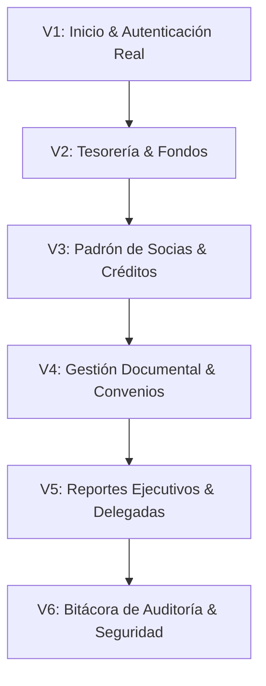

# Sistema Web de Gestión — Asociación VTF Temuco

Sistema web institucional responsive para la gestión administrativa, contable, financiera y de transparencia de la **Asociación de Jardines VTF Temuco** (Vía Transferencia de Fondos).

---

## 1. Contexto Institucional

La Asociación cuenta con:
- **280 socias activas y suspendidas** (Directoras, Educadoras y Técnicos en Educación Parvularia).
- **23 jardines infantiles** distribuidos en la comuna de Temuco.
- **23 delegadas** (una representante electa por cada establecimiento educativo).
- **Directiva Oficial:** Presidenta, Tesorera, Secretaria y Directora.
- **Cuota Social Mensual:** $4.000 CLP fijos con distribución tripartita estatutaria ($1.000 Federación Nacional, $1.000 Asociación, $2.000 Fondo Cena Anual).

---

## 2. Matriz Oficial de Roles y Permisos

| Rol | Titular Oficial | Identificador / RUT | Permisos Operativos | Visibilidad Financiera |
| :--- | :--- | :--- | :--- | :--- |
| **Super Admin** | Jhonny Marcelo Ferrada Pasten | `17.260.651-2` | Administración global del sistema, roles y base de datos | Acceso y modificación total |
| **Tesorera** | Alejandra Romanett Sias Novoa | `13.918.472-6` | Modificación de todo el sistema y dueña exclusiva del módulo Tesorería | Acceso financiero completo y registro de movimientos |
| **Presidenta** | Yerthie Johanna Sayago Gajardo | `15.421.368-7` | Supervisión general y modificación en toda la app | **Solo Lectura en Tesorería** (supervisión sin edición de gastos) |
| **Secretaria** | Nelly Ester Mella Burgos | `14.832.195-4` | Solo ver general, pero **puede agregar y modificar Socias** | Sin acceso a finanzas operativas |
| **Directora** | Victoria Catalina Abarza Vega | `16.274.593-8` | Solo ver general, con excepción en gestión de Convenios/Créditos | Resumen general autorizado |
| **Delegadas** | Representantes de Jardín (Ej: Claudia Navarro) | `17.890.123-1` | Representación de su establecimiento ante la asamblea | **Exclusivo módulo de Reportes** (prohibido ver deudas privadas) |

> **Nota:** La contraseña unificada de prueba para todas las cuentas de demostración es: `Admin123!`

---

## 3. Hoja de Ruta Segmentada por Versiones

El desarrollo del sistema está estructurado en versiones incrementales y especializadas:



### ✅ V1 — Inicio Institucional y Autenticación Real [COMPLETADA]
- **Identidad Oficial:** Integración del logo oficial de la Asociación VTF Temuco y sistema de diseño HSL institucional (morado suave, rosado suave, arena cálida y neutros).
- **Autenticación RBAC:** Soporte de acceso mediante **RUT chileno** (módulo 11) o correo institucional, con perfiles reales precargados.
- **Navbar Institucional:** Buscador global (*"Buscar en sistema..."*) y tarjeta de perfil activo con avatar, cargo y rol.
- **Dashboard de Inicio:**
  * **3 Recuadros KPI Superiores:** Socias Activas (276), Socias Suspendidas (4) y Saldo Total ($14.580.000 desglosado en Cena Anual $9.260.000 + Asociación $5.320.000).
  * **3 Recuadros Medianos:** Correlativo de los últimos 5 pagos a federación con comprobante respaldado, Próximas Tareas de tesorería y Alertas inteligentes (socias con última cuota y estado de aporte federación al día).
  * **2 Gráficos Analíticos:** Gráfico de Recaudación Mensual con selector interactivo de año (2026/2025) y Gráfico de Estado de Socias con créditos vigentes.

### ✅ V2 — Módulo Completo de Tesorería [COMPLETADA]
- **Centros de Costo Oficiales:**
  * `ASOCIACION`: Cuotas sociales ordinarias y gastos operativos/bienestar.
  * `CENA ANUAL`: Ahorro para el evento anual y préstamos de emergencia S.O.S.
  * `FEDERACION`: Exclusivo para registrar egresos/pagos del aporte nacional.
  * `ISI MUNDO COMISION`: Ingresos generados por el 2% de retorno de convenios.
- **7 Recuadros de Información Visible:** Total Ingresos, Total Egresos, Saldo Total (`Asociación + Cena Anual`), Total Movimientos, Pagos a Federación, Saldo Asociación y Saldo Cena Anual.
- **Regla Estricta de Egresos:** Prohibición absoluta de registrar egresos sin comprobante obligatorio adjunto.
- **Subida Real de Comprobantes:** Todo egreso exige adjuntar el archivo de respaldo (PDF, JPG, PNG o WEBP, máx. 5 MB). El archivo se guarda en `backend/uploads/` con nombre aleatorio y se visualiza desde la tabla con el botón *Ver* (cada descarga queda en auditoría). Los movimientos históricos se muestran como *Respaldo físico*.
- **Modal de Nuevo Movimiento:** Pestañas transaccionales diferenciadas para *Ingreso*, *Egreso* y *Pago Federación* con responsable automático de sesión.
- **Permisos Específicos:** Vista de *Solo Lectura* automática para la Presidenta y modo operativo de registro para la Tesorera y el Admin.
- **Filtros y Exportación:** Filtrado por tipo, centro de costo, método y fechas, con exportación completa a formato `.csv` compatible con Excel.

### ✅ V3 — Padrón de Socias y Gestión de Créditos [COMPLETADA — pendiente carga Excel]
- **Padrón de 280 socias** (276 activas + 4 suspendidas) con búsqueda por nombre o RUT y filtros por jardín, estado, cargo y crédito; paginación y exportación a `.csv`.
- **Cuota social:** $4.000 CLP para socias activas; las suspendidas se muestran *Sin cobro* (bloqueo de cobro indebido).
- **Columna CRÉDITO (SI / NO):** abre la ficha con los créditos vigentes y finalizados (`ISIMUNDO`, `S.O.S`, `OPTICA`, `DENTAL`), cuotas pagadas (ej: 3/6), valor cuota, saldo pendiente y comisión 2% Isi Mundo.
- **Alta y edición de socias** con validación de RUT (módulo 11) y RUT único. Permitido a Admin, Presidenta, Tesorera y Secretaria; la Directora consulta en modo lectura.
- **Traslados de jardín** con motivo obligatorio e historial; la delegada trasladada deja de representar a su jardín anterior.
- **Catálogo de los 23 jardines** con socias activas y delegada electa.
- Cada alta, edición y traslado queda en la bitácora de auditoría.
- Opera en memoria igual que Tesorería, a la espera de la conexión con PostgreSQL.
- ⏳ Pendiente: procesamiento y validación masiva de planillas Excel mensuales con SheetJS.

### ⏳ V4 — Gestión Documental y Subida Móvil
- **3 Subsecciones Documentales:**
  * *Documentos Maestros:* 4 contratos marco descargables para convenios.
  * *Carpetas por Empresa:* `ISIMUNDO`, `OPTICA`, `DENTAL`, `GIMNASIO` organizadas cronológicamente por año/mes/día con correlativo formal.
- Flujo de solicitud, firma y digitalización de pagarés y autorizaciones.
- Conexión PWA ligera para captura y subida rápida de comprobantes fotográficos desde el celular.

### ⏳ V5 — Reportes Ejecutivos y Portal Delegadas
- Vista dedicada y protegida exclusivamente para las **23 Delegadas** de jardín:
  * Monto total pagado a Federación.
  * Saldo consolidado Asociación + Cena Anual.
  * Socias activas por jardín.
  * **Protección estricta de privacidad:** Sin acceso a deudas individuales ni datos confidenciales de otras socias.
- Generación de informe oficial de **Rendición Anual de Cuentas** en PDF formal para asamblea.

### ⏳ V6 — Bitácora de Auditoría y Seguridad
- Trazabilidad forense inmutable de todas las acciones realizadas en la plataforma (inicios de sesión, creación de movimientos contables, cambios en socias y exportaciones).
- Metadatos con dirección IP, usuario, timestamp y detalle de cambios para respaldo legal.

---

## 4. Estructura del Proyecto

```text
dashboard/
├── backend/
│   ├── src/
│   │   ├── config/          # Variables de entorno y cliente Prisma
│   │   ├── controllers/     # AuthController, DashboardController, TreasuryController
│   │   ├── middlewares/     # authMiddleware, roleMiddleware, errorMiddleware
│   │   ├── routes/          # authRoutes, dashboardRoutes, treasuryRoutes, index
│   │   ├── services/        # AuthService, AuditService, DashboardService, TreasuryService, seedData
│   │   ├── utils/           # rutValidator, helpers
│   │   ├── validators/      # authValidator, treasuryValidator (Zod)
│   │   └── server.js        # Punto de entrada Express
│   ├── prisma/
│   │   ├── schema.prisma    # Esquema relacional PostgreSQL
│   │   └── seed.js          # Poblado de base de datos
│   ├── test/
│   │   └── authTest.js      # Pruebas automatizadas de autenticación y RBAC
│   └── package.json
├── frontend/
│   ├── public/
│   │   └── logo-vtf.png     # Logo oficial de la Asociación VTF Temuco
│   ├── src/
│   │   ├── components/      # UI institucional: Button, Input, Card, Badge, Sidebar, Navbar
│   │   ├── context/         # AuthContext (Sesión y roles RBAC), ThemeContext
│   │   ├── pages/           # LoginPage, DashboardPage (V1), TreasuryPage (V2), Placeholders (V3-V6)
│   │   ├── routes/          # AppRoutes, ProtectedRoute
│   │   ├── services/        # Cliente Axios y servicios API (auth, treasury)
│   │   ├── styles/          # index.css (tokens HSL, diseño responsivo, tipografías)
│   │   ├── App.jsx
│   │   └── main.jsx
│   ├── index.html
│   └── package.json
├── AGENTS.md                # Reglas de desarrollo Antigravity
├── .gitignore
├── package.json             # Scripts raíz
└── README.md
```

---

## 5. Instrucciones de Ejecución Local

### Paso 0: Instalación (solo la primera vez)
Requiere Node.js 20 o superior. PostgreSQL es opcional: sin base de datos el backend funciona en **modo memoria** con datos de demostración.
```powershell
cd backend
npm install
npx prisma generate
copy .env.example .env
cd ..\frontend
npm install
cd ..
```

### Paso 1: Iniciar Servidores de Desarrollo
En dos terminales PowerShell distintas, desde la carpeta `dashboard`:
```powershell
# Levantar backend en puerto 4000
npm run dev:backend

# Levantar frontend en puerto 5173
npm run dev:frontend
```

La aplicación estará disponible de inmediato en:
- **Frontend:** `http://localhost:5173`
- **Backend Health:** `http://localhost:4000/api/health`

### Paso 2: Ejecutar Pruebas Automatizadas
```powershell
npm run test:backend
```
Ejecuta las pruebas de autenticación (`authTest.js`), padrón de socias (`sociasTest.js`) y subida de comprobantes (`comprobantesTest.js`).
