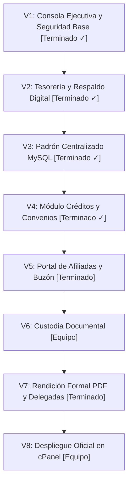

# SIGAV — Plan Maestro Unificado de Implementación y Gobernanza
### Sistema Integrado de Gestión Administrativa y Financiera
**Asociación Gremial de Trabajadores de Jardines Infantiles VTF — Temuco**

---

## 1. Contexto Institucional y Marco Estatutario

El **Sistema Integrado de Gestión Administrativa y Financiera (SIGAV)** es la plataforma oficial concebida para la gobernanza gremial, fiscalización contable, custodia documental, administración del padrón y rendición periódica de cuentas de los 23 jardines infantiles Vía Transferencia de Fondos (VTF) de Temuco y Labranza.

### Parámetros Operativos y Financieros Oficiales:
* **Cobertura Territorial:** 23 establecimientos educativos en Temuco y Labranza.
* **Padrón Representado:** 280 trabajadoras afiliadas (Directoras, Educadoras de Párvulos y Técnicos en Educación Parvularia).
* **Régimen Estatutario de Cuota Social:** Valor unificado de **$4.000 CLP mensuales** por afiliada activa:
  * **$1.000 CLP:** Aporte gremial ordinario a la Federación Nacional.
  * **$1.000 CLP:** Fondo operacional y de funcionamiento de la Asociación Local.
  * **$2.000 CLP:** Fondo de Bienestar y Evento Anual de Socias (Cena Anual).
* **Exención de Cobro:** Las socias con estado estatutario `SUSPENDIDA` quedan automáticamente exentas de la cuota social ($0 CLP).

---

## 2. Marco de Gobernanza, Roles y Privacidad (PoLP)

El sistema opera bajo el principio de **mínimo privilegio (PoLP)** y estricta **segregación de funciones**, garantizando la confidencialidad conforme a la Ley N° 19.628 sobre Protección de la Vida Privada:

| Nivel de Acceso | Perfil / Rol | Alcance Operativo | Perfil Financiero | Restricciones Estrictas |
| :--- | :--- | :--- | :--- | :--- |
| **Administración Técnica** | `ADMIN` / `SUPER_ADMIN` | Configuración, infraestructura, bitácora de auditoría y base de datos. | Supervisión contable técnica. | Sin autoasignación no auditada. |
| **Presidencia Gremial** | `PRESIDENTA` | Supervisión ejecutiva, representación institucional, noticias y buzón de socias. | **Supervisión (Solo Lectura)**; consulta de balances y movimientos. | **Sin edición ni creación** de egresos. |
| **Tesorería General** | `TESORERA` | Emisión de egresos, recaudación de ingresos, conciliación y comprobantes. | **Gestión Total** de Tesorería. | Obligatoriedad de respaldo digital en egresos. |
| **Secretaría General** | `SECRETARIA` | Administración del Padrón (altas, bajas, traslados, planilla y restablecer clave del portal), noticias, buzón e informe mensual. | Sin acceso a finanzas operativas. | Sin Tesorería, pagos a la Federación, tareas, alertas ni recaudación. Ve solo la ficha socia (sin créditos). |
| **Dirección de Bienestar** | `DIRECTORA` | Desde el 16-11-2026 tiene los mismos permisos que la Secretaria (padrón, noticias, buzón e informe mensual). | Sin acceso a finanzas operativas. | **Bloqueo estricto de Tesorería general**; sin datos de créditos hasta que V4 defina su alcance. |
| **Delegadas de Base** | `DELEGADA` | Representación de su establecimiento (23) ante la asamblea. | Entran con su cuenta del **portal de socias** si están marcadas como delegadas en el padrón: **"Mi jardín"** (cifras de su jardín), informe mensual en Excel y Balance Anual en PDF. | **Bloqueo estricto de deudas y saldos individuales**. |
| **Portal de Afiliadas** | `SOCIA` | Ficha personal, aportes individuales, consulta de noticias y buzón gremial. | Solo su propio estado y cuota. | Solo accede con su RUT personal. |

---

## 3. Arquitectura del Sistema

```text
dashboard/
├── backend/
│   ├── src/
│   │   ├── config/          # Pool MySQL (mysql2/promise) y variables de entorno seguras
│   │   ├── controllers/     # Controladores REST desacoplados por dominio
│   │   ├── middlewares/     # JWT, RBAC, auditoría forense, upload Multer y control primer ingreso
│   │   ├── routes/          # Enrutamiento API RESTful modular
│   │   ├── services/        # Servicios de dominio transaccionales (Tesorería, Socias, Créditos)
│   │   ├── utils/           # Validador oficial de RUT (Módulo 11) y helpers
│   │   ├── validators/      # Esquemas de integridad Zod
│   │   └── server.js        # Servidor Express, CORS estricto y middleware de errores
│   ├── database/            # DDL/DML saneados para importación cPanel/MySQL
│   ├── test/                # Suites de verificación automatizadas (auth, socias, comprobantes, treasury, portal)
│   └── uploads/             # Bóveda privada de comprobantes digitales (fuera de public_html)
├── frontend/
│   ├── src/
│   │   ├── components/      # Componentes UI (SIGAV Design System, modales, tablas)
│   │   ├── context/         # AuthContext, ThemeContext (modo oscuro HSL)
│   │   ├── pages/           # Vistas corporativas (Dashboard, Tesorería, Socias, Créditos, Portal)
│   │   ├── routes/          # Rutas protegidas por rol con React Router v6
│   │   ├── services/        # Clientes API Axios/Fetch con interceptores JWT
│   │   └── styles/          # Tokens HSL y estilos institucionales
│   ├── public/              # Isotipo y .htaccess para soporte SPA en Apache
│   └── vite.config.js       # Bundler Vite
└── docs/                    # Documentación, bitácora de desarrollo y tema SIGAV
```

---

## 4. Estado de Avance y Hoja de Ruta de Versiones

### Matriz de Seguimiento por Versiones

| Versión | Módulo / Hito | Responsable | Estado | Evidencia y Commits |
| :---: | :--- | :--- | :---: | :--- |
| **V1** | **Consola Ejecutiva, Directiva y Seguridad Base (PoLP)** | **Sebastian Olguín** | **Terminado ✓** | Commits `2a194fb`, `a768d64` (39 tests OK) |
| **V2** | **Tesorería Robusta y Respaldo Digital Obligatorio** | **Sebastian Olguín** | **Terminado ✓** | Commit `c3608ed` (46 tests OK) |
| **V3** | **Padrón Centralizado 100% Persistente en MySQL** | **Sebastian Victoriano** | **Terminado ✓** | 75 tests OK; con ajustes de la directiva y auditoría: 110 tests OK (`e8abdb7`) |
| **V4** | **Módulo Independiente de Créditos y Convenios** | Sebastian Victoriano | **Terminado ✓** | Commit `4c1c5dc` (124 tests OK) |
| **V5** | **Portal de Afiliadas, Primer Ingreso y Buzón Gremial** | Sebastian A. y Braulio P. | **Terminado ✓** | Comunicaciones de la directiva, recuperación de clave (`e8abdb7`, `68ede07`), S.O.S en línea (`ab12830`) y revisión final del portal (17-11-2026) |
| **V6** | **Custodia Documental y Carpeta por Proveedor** | Equipo Técnico | **Pendiente (Equipo)** | Asignado para resolución del equipo |
| **V7** | **Rendición Formal de Cuentas (PDF) y Portal Delegadas** | Equipo Técnico | **Terminado** | Informe mensual con Excel (`e8abdb7`), Balance Anual en PDF y cifras por jardín ("Mi jardín" en el portal de la delegada) |
| **V8** | **Validación Integral E2E y Despliegue Oficial en cPanel** | Equipo Completo | **Pendiente (Equipo)** | Asignado para resolución del equipo |



---

### Versión 1: Consola Ejecutiva, Directiva y Seguridad Base
> [!IMPORTANT]
> **Estado:** **Terminado ✓**  
> **Responsable:** Sebastian Olguín  
> **Commits:** `2a194fb`, `a768d64`  
> **Resultados Aprobados:** 12/12 pruebas de seguridad aprobadas (`npm run test:auth`).

#### 1. Archivos Remediados
- `database/database.sql`: Saneamiento DDL (remover `DROP DATABASE` y prefijos fijos incompatibles con cPanel). Agregada columna `estado ENUM('ACTIVA', 'SUSPENDIDA') DEFAULT 'ACTIVA'` en tabla `socias`.
- `database/admin.sql`: Hasheo bcrypt (costo 10) de cuentas operativas (`Admin123!` $\rightarrow$ `$2b$10$...`).
- `backend/src/config/env.js`: Validación estricta de variables de entorno y advertencia por `JWT_SECRET` por defecto.
- `backend/src/config/db.js`: Conexión determinística y comprobación de disponibilidad activa con inspección de códigos de error.
- `backend/src/services/authService.js`: Eliminación de comparación en texto plano, verificación de usuario `activo === 1` y resolución dinámica de alias de correo (`@vtf.cl` y `@asociacionvtf.cl`).
- `backend/src/middlewares/authMiddleware.js`: Verificación de vigencia y usuario activo en cada petición HTTP (403 Forbidden para usuarios inactivos).
- `backend/src/services/dashboardService.js`: Desacoplar saldos de Tesorería de `baseSummary` para no enviarlos a Directora, Delegadas ni Socias (Principio de Mínimo Privilegio).
- `backend/src/routes/treasuryRoutes.js`: Bloqueo estricto de rutas financieras a roles no autorizados (Directora rechazada con 403).
- `frontend/src/routes/AppRoutes.jsx` y `Sidebar.jsx`: Protección visual y de rutas para Tesorería.

---

### Versión 2: Tesorería Robusta y Respaldo Digital Obligatorio
> [!IMPORTANT]
> **Estado:** **Terminado ✓**  
> **Responsable:** Sebastian Olguín  
> **Commit:** `c3608ed`  
> **Resultados Aprobados:** 46/46 pruebas de backend aprobadas (`comprobantesTest.js` 11/11, `treasuryPersistenceTest.js` 4/4). Build Vite limpio en 7.63s.

#### 1. Archivos Remediados
- `database/database.sql` y MySQL: Nuevas columnas en `movimientos_tesoreria` (`comprobante_stored VARCHAR(255)`, `comprobante_mime VARCHAR(100)`, `comprobante_size INT`) y tipo modificado a `ENUM('INGRESO', 'EGRESO', 'SALDO_APERTURA')`.
- `database/data.sql`: Asientos oficiales de apertura contable de 2026: `MOV-2026-000A` ($5.103.000, Asociación) y `MOV-2026-000B` ($8.856.000, Cena Anual).
- `backend/src/validators/treasuryValidator.js`: Validación estricta Zod: montos forzados a números enteros en CLP (`.int()`), validación de fechas reales en calendario gregoriano (rechazando fechas inexistentes como el 30 de febrero) y centros de costo canónicos.
- `backend/src/services/treasuryService.js`:
  - **Correlativos Atómicos:** Sustitución de `COUNT(*) + 1` por consulta secuencial numérica con expresión regular (`MOV-YYYY-XXX`), eliminando colisiones bajo concurrencia.
  - **Persistencia de Archivos:** Inserción y lectura de `comprobante_stored`, `mime` y `size` en MySQL, garantizando la descarga de comprobantes tras el reinicio del servidor Node.
  - **Cálculo de Saldos sin Números Mágicos:** Suma dinámica basada en transacciones `SALDO_APERTURA`.
- `backend/src/controllers/treasuryController.js`: Descarga garantizada vía `storedName` desde el disco mediante la metadata persistida en base de datos.
- `frontend/src/pages/TreasuryPage.jsx`: Renderizado de insignia informativa (`.vtf-badge-info`) para transacciones de tipo `SALDO_APERTURA`.

---

### Hotfix 2026-11-09: Bloqueantes del despliegue en cPanel
> [!IMPORTANT]
> **Estado:** **Terminado ✓** (pendiente de aplicar en el hosting)  
> **Resultados:** 57 pruebas de backend aprobadas (`npm test`, incluye la nueva `test/bloqueantesTest.js`). Build Vite limpio.

#### 1. Bugs corregidos y causa
- **Producción corría sin base de datos y mostraba datos de prueba.** Las capturas mostraban "Jardín Rayito de Sol", que solo existe en `seedData.js`, el respaldo en memoria. La causa fue el nombre de usuario o de base sin el prefijo de cPanel (`vtftemuc_`), sumado a que nada esperaba la conexión inicial: las primeras peticiones del arranque en frío de Passenger se atendían en memoria. Ahora `db.js` espera el primer intento (`waitForDatabase`) y reintenta cada 15 s. En producción la API responde **503** en vez de usar datos de memoria (`ALLOW_MEMORY_FALLBACK`), y `/api/health` informa `database.conectada` junto con el código de error.
- **"No fue posible cargar las métricas":** era una consecuencia del punto anterior (sesión emitida en memoria y validada contra MySQL, o un timeout del arranque en frío). Ahora el dashboard muestra el motivo real y el timeout del cliente subió a 20 s.
- **Correos @vtftemuco.cl rechazados:** ahora el login acepta **solo** el correo exacto `@vtftemuco.cl` o el RUT (con o sin puntos). Se eliminaron los dominios `@vtf.cl` y `@asociacionvtf.cl` y los alias (`tesoreria@`, `alejandra.sias@`…).
- **La clave inicial de la socia seguía sirviendo después de cambiarla:** se eliminó esa excepción en `sociaAuthService.js`. Además, la nueva clave no puede ser la inicial.
- **RUTs ficticios de la directiva en `admin.sql`:** se reemplazaron por los del padrón y se cambiaron los correos a `@vtftemuco.cl`.
- **Misma clave para toda la directiva y sin cambio obligatorio:** se agregó la columna `administradores.primer_ingreso`, la ruta `POST /api/auth/cambiar-clave` con política mínima, un bloqueo en el servidor (403 `PASSWORD_CHANGE_REQUIRED`) y un modal bloqueante en el frontend. "¿Olvidó su contraseña?" ahora explica el procedimiento.
- `server.js` y `app.cjs` ahora incluyen los ajustes que antes existían solo en el paquete de despliegue (Passenger, mismo dominio, frontend en `public/`).

#### 2. Aplicación en el hosting
1. En la base ya instalada, ejecutar `database/migraciones/2026-11-09_directiva_y_primer_ingreso.sql`.
2. Corregir `DB_NAME` y `DB_USER` con el prefijo (ver `docs/GUIA_DESPLIEGUE_CPANEL.md`), subir el código nuevo y hacer Restart.
3. Comprobar que `https://vtftemuco.cl/api/health` responda `"conectada": true`.

#### Monto leído del comprobante (17-11-2026, pedido de la directiva)
Al adjuntar el comprobante, el monto se lee en el navegador y se **propone** en el campo Monto; la tesorera lo revisa antes de guardar.
- `frontend/src/utils/montoComprobante.js`: elige el monto del texto: primero "Monto transferido", "Total a pagar" o "Total"; luego "Monto", "Importe" o "Valor"; si no hay, el mayor monto con `$`. Descarta subtotal, IVA, neto, saldo, efectivo y vuelto, y no confunde RUT, fechas, horas ni porcentajes. 10 pruebas en `montoComprobante.test.js` (`npm test` en `frontend/`).
- `frontend/src/services/lectorComprobante.js`: PDF con `pdfjs-dist` (texto incrustado); imágenes con `tesseract.js` en español, primero en segmentación automática (pantallazos) y, si no encuentra el monto, en bloque único (boletas). Las librerías se cargan solo al adjuntar.
- `frontend/public/ocr/`: núcleo del OCR (con y sin SIMD) y el modelo `spa`, servidos desde el propio sitio: el comprobante no sale del equipo.
- `frontend/src/components/treasury/ComprobanteInput.jsx`: en computador, **Adjuntar**; en pantallas táctiles, **Tomar foto** (cámara trasera) y **Subir**. `utils/comprimirImagen.js` lleva las fotos a 2000 px en JPEG (una foto de 6 MB quedaba fuera del máximo de 5 MB).
- `backend/src/server.js`: la CSP agrega `'wasm-unsafe-eval'` (WebAssembly del OCR); el resto de la política de helmet no cambia.
- Si el monto ya estaba escrito, no se pisa: se ofrece **Usar $X**. Si no se encuentra, se pide ingresarlo a mano.

---

### Versión 3: Padrón Centralizado 100% Persistente en MySQL
> [!IMPORTANT]
> **Estado:** **Terminado ✓** (pendiente de aplicar en el hosting)  
> **Responsable:** Sebastian Victoriano  
> **Resultados:** 75 pruebas de backend aprobadas en 7 suites (`npm test`, sobre la base de prueba `jardines_vtf_test`). Build Vite limpio. Lectura verificada con la planilla real "Maestra Socias": 277 filas, 0 errores.

#### 1. Decisiones de negocio
- **Cargos:** DIRECTORA, EDUCADORA, TECNICO, ASISTENTE, AUXILIAR y `SIN DATO` (22 socias del padrón real sin cargo, para completar).
- **Eliminar socia = baja lógica (`RETIRADA`)** con motivo y fecha. No cuenta ni cobra cuota, conserva créditos e historial y se reactiva editando su estado. El borrado físico de una socia con créditos queda bloqueado en la base (`ON DELETE RESTRICT`).
- **Planilla Maestra Socias:** vista previa y luego aplicación en una sola transacción. Las celdas vacías no borran datos. Las socias ausentes en la planilla **no** se dan de baja solas: se listan para revisión. Cada archivo se guarda en `uploads/padron/AAAA/MM/` sin sobrescribir y queda registrado en `cargas_padron`.
- **Se eliminó el padrón ficticio en memoria** (`sociasSeedData.js`). El portal de socias y el padrón trabajan solo con MySQL.

#### 2. Archivos
- `database/database.sql` y `data.sql`: tablas `jardines` (23), `historial_traslados` y `cargas_padron`. La socia pasa a `jardin_id` y suma `fecha_ingreso`, `es_delegada`, retiro y marcas de tiempo. Celulares en `+569XXXXXXXX` y correos en minúscula.
- `database/migraciones/2026-11-09_v3_padron_mysql.sql`: migración de bases ya instaladas.
- `backend/src/services/sociaService.js`: SQL parametrizado con paginación en el servidor, búsqueda por nombre, RUT (con o sin puntos), jardín o correo, y traslados transaccionales.
- `backend/src/services/padronImportService.js`, `utils/sociaFormat.js` y `validators/sociaValidator.js`.
- `frontend/src/pages/SociasPage.jsx` y `components/socias/*`: recuadros de la especificación, filtros (incluye "sin jardín" y "retiradas"), retiro con motivo, carga de Excel con vista previa y exportación completa según el filtro.
- `backend/test/run.js`: crea la base de prueba desde los SQL del repositorio y corre cada suite contra ella. Nunca toca la base de desarrollo.

#### 3. Bugs corregidos en el camino
- **Una socia suspendida conservaba el acceso al portal:** `getProfile` capturaba su propio error y devolvía un perfil genérico activo. Ahora también se exige el estado ACTIVA al iniciar sesión.
- **La bitácora nunca se guardaba en MySQL:** enviaba `admin-N` a la columna numérica `usuario_id`. Ahora guarda el número.
- **El Inicio mostraba números fijos del padrón** (280, 4 suspendidas, 98,6 %). Ahora se calculan con los datos reales.

#### 4. Criterios de Aceptación (verificados en `sociasTest.js` y `padronImportTest.js`)
- Crear una socia vía API, levantar un segundo backend y encontrarla en MySQL.
- Un traslado sin motivo falla con 400 sin alterar el jardín ni ningún otro dato (transacción).
- Una planilla aplicada dos veces no duplica ni cambia nada.

---

### Revisión previa al despliegue desde cero (09-11-2026)
> [!IMPORTANT]
> **Estado:** **Terminado ✓**  
> **Resultados:** 77 pruebas de backend aprobadas en 7 suites (`npm test`). Build Vite limpio. Paquete de producción probado en local con `NODE_ENV=production`. La guía `docs/GUIA_DESPLIEGUE_CPANEL.md` se reescribió para una instalación desde cero.

#### 1. Bugs corregidos y causa
- **Tesorería "guardaba" en memoria si MySQL fallaba:** si una consulta fallaba con la base conectada, el movimiento quedaba solo en memoria, se respondía "registrado exitosamente" y se perdía al reiniciar. El resumen y el libro mostraban además movimientos de ejemplo. Ahora el error se informa; la memoria se usa solo sin base de datos (desarrollo y tests).
- **Saldos y comisión con montos fijos:** sin asientos de apertura se usaban $5.103.000 y $8.856.000 escritos en el código, y la comisión Isi Mundo mostraba $54.200 cuando era 0. Ahora todo sale de la base.
- **El Inicio mostraba créditos, alertas y gráfico inventados:** la pantalla tenía 38/24/19/195 fijos; el backend reemplazaba un 0 real por esos números y restaba dos veces a una socia con dos créditos. Las alertas de última cuota (6 y 3) y el gráfico mensual también eran fijos. Ahora se calculan con socias distintas, cuotas restantes y movimientos reales por mes.
- **La socia con clave equivocada era enviada al login de la directiva:** el interceptor de 401 recargaba la página hacia `/login` y la socia nunca veía el error. También cerraba la sesión de quien usara el mismo navegador.
- **El mensaje de clave incorrecta revelaba la clave inicial del RUT ingresado.** Ahora muestra un ejemplo genérico.
- **Tras el primer cambio de clave, el portal quedaba sin nombre, RUT ni jardín** hasta recargar, y "Cerrar sesión" llevaba al login de la directiva.
- **`JWT_SECRET` por defecto en producción solo daba un aviso:** la clave está en el repositorio y permitía fabricar sesiones. Ahora la app no arranca en producción sin una clave propia de 32 caracteres o más.
- **Cuenta de delegada de demostración activa con `Admin123!`:** en una instalación nueva cualquiera podía tomarla. `admin.sql` la crea desactivada.
- **Fechas en UTC:** la fecha de ingreso, el retiro (`CURDATE()` del servidor), las cargas de planilla y las noticias quedaban con el día siguiente después de las 21:00 en Chile. Ahora usan la hora de Chile (`utils/fecha.js`).
- **Bitácora del Inicio vacía en MySQL 8:** `LIMIT ?` con `execute` falla en MySQL 8 y caía en silencio a la memoria; un detalle no JSON también la vaciaba.
- **Noticias:** el autor quedaba como "Nombre ([object Object])" y, al borrar todas las noticias, reaparecían las de ejemplo.
- **CSV de Tesorería:** un `;` en la categoría o el comprobante corría las columnas, y no se protegía contra fórmulas de Excel.
- **Build sin `VITE_API_URL`** apuntaba a `localhost:4000`. Ahora el build de producción usa `/api` del mismo dominio.

#### 2. Datos para producción
- `data.sql` deja en Tesorería solo los 2 saldos de apertura oficiales de 2026. Se quitaron 10 movimientos y 3 noticias de demostración (por ejemplo, un S.O.S del inexistente "Jardín Campanita"). La Tesorera registra en el sistema los movimientos reales con su comprobante.
- Se conservan las liquidaciones de octubre de 2026: coinciden con la cuota más los créditos reales en 259 de 277 socias.

---

### Cierre de hallazgos de la auditoría preliminar (10-11-2026)
> [!IMPORTANT]
> **Estado:** **Terminado ✓**  
> **Resultados:** 83 pruebas de backend aprobadas en 7 suites (`npm test`). Build Vite limpio.

Se cotejó el *Informe preliminar de auditoría técnica* (03-11-2026) contra el código. Los hallazgos críticos ya estaban resueltos por V1, V2, V3 y la revisión del 09-11. Se corrigieron los pendientes menores:
- **Tesorería respondía 400 ante cualquier error**, incluso fallas de MySQL, y mostraba el mensaje técnico. Ahora las reglas de negocio (`TreasuryError`) responden 400 y las fallas internas pasan al middleware central (500 sin detalles en producción).
- **La API aceptaba `SALDO_APERTURA`** como tipo de movimiento. Ahora solo `INGRESO` o `EGRESO`; los saldos de apertura se cargan con `data.sql`.
- **Login:** cualquier error respondía 401, y una falla de MySQL parecía "credenciales inválidas". Ahora los rechazos (`LoginError`) responden 401 y las fallas internas 500.
- **Límite de intentos** (`middlewares/loginLimiter.js`) en el login de directiva y de socias: 5 intentos fallidos en 15 minutos bloquean la cuenta (RUT o correo, por IP) durante 15 minutos con respuesta 429.
- **Contenido real de los archivos:** comprobantes y adjuntos del buzón se validan por su firma (PDF, JPG, PNG, WEBP) y las planillas como `.xlsx` real, no solo por el tipo que declara el navegador.
- **Delegadas:** el Inicio las cuenta con `socias.es_delegada` en vez de usar el número de jardines. *En el padrón real ninguna socia está marcada aún como delegada: la directiva debe marcarlas.*
- Se eliminó código sin uso (`registerUserSchema`, con roles inexistentes, y referencias a `SUPER_ADMIN` en el dashboard).

**Pendiente de decisión de la directiva:** alcance de la Directora en el padrón y cierre inmediato de sesiones. *Ambos resueltos el 17-11-2026 (ver la sección siguiente).*

---

### Ajustes de la directiva y cierre de la auditoría de seguridad (17-11-2026)
> [!IMPORTANT]
> **Estado:** **Terminado ✓** (pendiente de aplicar en el hosting)  
> **Responsable:** Sebastian Victoriano  
> **Commits:** `e8abdb7`, `68ede07`  
> **Resultados:** 110 pruebas de backend aprobadas en 8 suites (`npm test`; la nueva suite `test/accesosTest.js` cubre la matriz de accesos por rol). Build Vite limpio. Verificado en el navegador con cada rol.

#### 1. Pedidos de la directiva (lista "DATOS VTF VERIFICADOS 10-11")
- **Login de la directiva solo con RUT.** Se eliminó el ingreso por correo. Todos los campos de contraseña tienen el botón para mostrarla u ocultarla, y el RUT de las socias no acepta letras (`RutInput.jsx`).
- **Cierre por inactividad:** aviso al minuto 9 y cierre de sesión a los 10 minutos sin actividad (`useIdleTimeout.js`, `IdleSessionGuard.jsx`).
- **Sitio responsivo** y sin el buscador superior, que no funcionaba.
- **Tesorería:** el botón "Agregar Movimiento" no abría el formulario. La causa era la llamada a una función inexistente (`setFormError`), que lanzaba un error.
- **Permisos por rol** (`frontend/src/utils/permissions.js`, espejo de `requireRole` en el backend):
  - La Secretaria no ve pagos a la Federación, tareas, alertas, recaudación ni Tesorería (`secciones.finanzas = false` en el Inicio).
  - La Directora 1 recibe los mismos permisos que la Secretaria.
- **Ficha socia y ficha crédito separadas** (`CreditoDetailModal.jsx`). Los datos de crédito llegan solo a Admin, Presidenta y Tesorera; para el resto el backend los quita de la respuesta.
- **Resumen de créditos en PDF** (pedido en la nota de la sección Socias): ícono junto al "SI" del padrón y botón "Descargar PDF" en la ficha de crédito (`GET /api/socias/:id/creditos/pdf`, solo Admin, Presidenta y Tesorera, con auditoría). Una fila por crédito con empresa, monto, cuotas pagadas/total, valor cuota, saldo y estado; los anulados no aparecen. Usa `pdfkit` y el módulo común `backend/src/utils/pdf.js`, que también servirá para el Balance Anual. Se corrigió además la ficha de crédito, que mostraba 0 vigentes y saldo $0. 3 pruebas nuevas en `creditosTest.js` (160 en total).
- **Comunicaciones** (`ComunicacionesPage.jsx`): Admin, Presidenta, Secretaria y Directora publican y eliminan noticias, leen el buzón de las socias, marcan los mensajes como leídos o respondidos y descargan los adjuntos.
- **Informe mensual** (`ReportesPage.jsx`, `GET /api/reportes/mensual`): pago a la Federación, total de egresos, total disponible y cantidad de movimientos, con exportación a Excel. Las delegadas lo ven en modo solo lectura (adelanto de V7).
- **Recuperación de clave de socia:** desde Socias → Ficha socia → "Restablecer clave". La clave vuelve a los 6 primeros dígitos del RUT con cambio obligatorio, se cierran sus sesiones y queda en la auditoría (H-008). La clave inicial se mantiene por decisión de la directiva (H-001).

#### 2. Auditoría de seguridad (27 hallazgos)
- **Sesiones revocables (H-005):** cada token lleva un identificador único. Cerrar sesión lo invalida (`sesiones_revocadas`) y cambiar la contraseña cierra las demás sesiones de la persona (`sesiones_corte`). Las tablas se crean solas; la migración `2026-11-17_sesiones_revocadas.sql` es opcional.
- **Login sin enumeración de cuentas:** el mismo mensaje y el mismo tiempo de respuesta para un RUT inexistente, una clave incorrecta o una cuenta inactiva.
- **Configuración:**
  - Sin `JWT_SECRET` por defecto en ningún entorno, salvo en las pruebas.
  - `CORS_ORIGIN` obligatorio en producción.
  - Cuerpo de las peticiones limitado a 100 KB.
  - `/api/health` sin datos internos y errores 500 sin detalles en producción.
- **Validación con zod en todos los endpoints** (`portalValidator.js`, filtros de Tesorería y del padrón). Además, `validateIdParam.js` rechaza con 400 los `:id` no numéricos.
- **Planilla Excel protegida** (`utils/xlsxGuard.js`): antes de abrirla se revisa el ZIP (máximo 40 MB descomprimido, 300 elementos y compresión normal). Además, máximo 5000 filas y 60 columnas.
- **Auditoría sin pérdidas:** si MySQL falla, el evento se guarda en `backend/logs/auditoria-pendiente.jsonl` y se traspasa a la tabla al volver la conexión.
- **Montos:** tope de $100.000.000 por movimiento.
- **Pruebas de aislamiento y de accesos:**
  - Una socia no ve los mensajes de otra.
  - La inyección SQL en búsquedas y filtros no altera las consultas.
  - Se probó la matriz completa de accesos por rol.

#### 3. Bugs corregidos y causa
- **El buzón guardaba todos los mensajes como CONSULTA:** el portal enviaba "Consultas" o "Reclamos" y el backend no reconocía esas palabras. Ahora se envía el código y se aceptan las palabras antiguas. Los mensajes anteriores no se pueden reclasificar automáticamente.
- **Botón "Agregar Movimiento" de Tesorería:** ver el punto 1.

#### 4. Pendiente
- **Revisar en cPanel:** H-021, H-022, H-023 y H-027 (configuración del servidor).
- **Dependencias con actualización mayor (H-024):** `uuid` (vía exceljs), `react-router` y el `zod` del frontend. Quedan para V8.
- **H-004:** pospuesto a V8.
- **Cierre por inactividad en el servidor:** hoy lo controla solo el navegador.
- **Delegadas:** la directiva entregó 21 de las 23 (17-11-2026); `database/migraciones/2026-11-23_delegadas_jardines.sql` las marca en cPanel. Faltan J-04 Gabriela Mistral y J-10 Los Jardines de Labranza.

#### 5. Aplicación en el hosting
1. Subir el código y configurar `CORS_ORIGIN=https://vtftemuco.cl` y un `JWT_SECRET` propio de 32 caracteres o más.
2. Hacer Restart de la aplicación y comprobar `https://vtftemuco.cl/api/health`.

---

### Versión 4: Módulo Independiente de Créditos y Convenios Sociales
> [!IMPORTANT]
> **Estado:** **Terminado ✓** (pendiente de aplicar en el hosting)  
> **Responsable:** Sebastian Victoriano  
> **Commit:** `4c1c5dc`  
> **Resultados:** 124 pruebas de backend aprobadas en 9 suites (`npm test`; la nueva `test/creditosTest.js` tiene 13). Build Vite limpio. Planilla real "Maestra Créditos" leída y aplicada en la base de prueba; pantalla verificada con la Tesorera y la Presidenta, en escritorio y móvil, en modo claro y oscuro.

#### 1. Decisiones de negocio (18-11-2026)
- **Cinco empresas:** S.O.S, ISIMUNDO, Óptica, Dental y **Abogada**, que se trata como la quinta empresa porque ya viene en la planilla.
- **Permisos:** ven Créditos Admin, Presidenta (solo lectura) y Tesorera. Cargan la planilla y verifican pagos solo Admin y Tesorera. La Directora sigue sin acceso hasta que la directiva lo defina.
- **Sin egreso automático:** verificar un pago no crea un movimiento en Tesorería; la Tesorera lo registra aparte si corresponde.
- **Cuotas:** la cuota del mes cargado queda pendiente hasta que se verifica el pago (días 1 al 5); recién ahí suman las cuotas pagadas.

#### 2. Flujo mensual
1. **Día 18 — Planilla Maestra Créditos** (`creditImportService.js`): vista previa y aplicación en una transacción.
   - Lee las hojas SOS, ISIMUNDO, Optica, Dental y Abogada y la hoja resumen (Hoja1). El resumen define el monto **A PAGAR** de cada empresa en el mes.
   - Cada crédito se identifica por socia + empresa + clave (ISIMUNDO: N° de crédito; resto: mes de la primera cuota). Subir dos veces la misma planilla no duplica nada.
   - Las cuotas descontadas nunca se modifican; las pendientes se ajustan a la planilla.
   - Los créditos que la planilla ya no trae se listan para revisión, sin cerrarse solos.
   - Un RUT con el dígito verificador mal escrito se asigna a la socia del padrón con el mismo número, y se avisa.
   - El archivo queda en `uploads/creditos/planillas/AAAA/MM/` y en la tabla `cargas_creditos`.
2. **Días 1 al 5 — Verificación de pagos** (`creditService.js`): un comprobante (PDF o foto) por empresa. En una transacción:
   - Marca como descontadas las cuotas del mes.
   - Recalcula los créditos: cuotas pagadas, última cuota y pagado.
   - Registra el pago en `pagos_convenio`.

   Cada comprobante queda en `uploads/creditos/comprobantes/AAAA/MM/EMPRESA/`, sin sobrescribirse. Un mes ya verificado no se puede verificar de nuevo, y su monto a pagar no cambia.
3. **Pantalla** (`CreditosPage.jsx` y `components/creditos/`):
   - Tarjetas por empresa con "A pagar" y "Último pago".
   - Verificación mensual.
   - Historial con búsqueda, filtros y ficha (calendario de cuotas y monto pendiente).
   - Gráfico de créditos vigentes y en última cuota por empresa, con vista en tabla.

   Los créditos pagados se ocultan un mes después de pagarse (D4).

#### 3. Base de datos
- Migración `database/migraciones/2026-11-18_v4_creditos.sql` (también incluida en `database.sql` y `data.sql`):
  - `convenios.codigo` y `convenios.orden`.
  - `creditos.clave_carga` y `creditos.fecha_finalizacion`.
  - Índice por período en `cuotas_credito`.
  - Tablas `cargas_creditos` y `pagos_convenio`.
- No borra ni cambia los créditos existentes.

#### 4. Bugs corregidos en el camino
- **El pago verificado podía quedar en $0:** se sumaban las cuotas que el sistema marcaba en ese momento, y si ya estaban descontadas el monto era 0. Ahora el monto pagado es el monto A PAGAR del mes, que es lo que respalda el comprobante.
- **La planilla real trae RUT con el dígito verificador mal escrito** (3 filas de SOS): ahora se asignan por el cuerpo del RUT cuando la socia existe, y se informa.

#### 5. Ingreso manual de créditos (ajuste posterior a V4)
Pedido de la directiva: la Tesorera debe poder "ingresar montos y modificar registros" sin depender del Excel.
- **Nuevo crédito** (`CreditoFormModal.jsx`, `creditManualService.js`, `POST /api/creditos`): socia, empresa, N° de crédito (obligatorio en ISIMUNDO), valor cuota, total de cuotas, mes de la primera cuota y cuotas ya pagadas. Usa la misma clave que la planilla, así la del día 18 lo reconoce y no lo duplica.
- **Desde la ficha:** Editar (solo cambian las cuotas pendientes), **Registrar prepago** (las pendientes quedan "prepagadas" y el crédito, pagado) y **Anular** con motivo (deja de cobrarse; si la planilla lo vuelve a traer, sigue anulado).
- **Colores de estado** de la reunión: "Quedan 2 cuotas" (naranjo), "Última cuota" (rojo suave), "Pagado" (verde).
- Migración `database/migraciones/2026-11-19_creditos_manual.sql`: `creditos.origen`, `motivo_anulacion`, `fecha_anulacion` y el estado de cuota `prepagada`.
- **Bug corregido:** la alerta "Socias con 1 cuota restante" del Inicio mostraba 6 y 3 de ejemplo cuando no llegaban datos, y su botón abría un texto fijo. Ahora muestra las cifras reales y lleva a Créditos filtrado por "Última cuota".
- 7 pruebas nuevas en `creditosTest.js` (131 en total).

#### 6. Corrección de movimientos de Tesorería (ajuste posterior a V4)
Pedido de la reunión: la Tesorera "modifica registros". Antes un movimiento mal digitado no se podía corregir.
- **Editar** (`PUT /api/tesoreria/movimientos/:id`, mismo modal del alta): fecha, monto, descripción, método, categoría y, opcional, un comprobante nuevo que reemplaza al anterior (el archivo anterior se conserva en el servidor). El tipo no cambia: si está mal, se anula y se registra de nuevo.
- **Anular** (`POST /api/tesoreria/movimientos/:id/anular`) con motivo obligatorio. El movimiento queda en el libro, tachado y con su motivo, para la comisión revisadora; deja de sumar en saldos, Inicio, informe mensual y Excel.
- Los saldos de apertura no se editan ni se anulan. Solo Tesorera y Admin; la auditoría guarda el antes y el después de cada edición.
- Migración `database/migraciones/2026-11-20_tesoreria_correcciones.sql`. 6 pruebas nuevas en `treasuryPersistenceTest.js` (137 en total).

#### 7. Liquidación para el empleador (ajuste posterior a V4)
Pedido de la reunión: exportar en Excel lo que se descuenta por planilla, desglosado por convenio.
- Tarjeta **"Liquidación para el empleador"** en Créditos y Convenios (`LiquidacionCard.jsx`, `liquidacionService.js`): elige mes y año, muestra el total a descontar, la cuota social y el total de cada empresa, y descarga el Excel.
- **Excel** (`GET /api/creditos/liquidacion/excel`): hoja "Liquidación" con una fila por socia (RUT, nombre, jardín, cuota social, S.O.S, ISIMUNDO, Óptica, Dental, Abogada y total) y hoja "Resumen" con el total por empresa y el reparto de la cuota social ($1.000 Federación, $1.000 Asociación, $2.000 Cena Anual).
- Reglas: cuota social solo para socias ACTIVAS; cuentan las cuotas pendientes o descontadas del mes; las prepagadas, condonadas y de créditos anulados no se descuentan.
- La ven Admin, Presidenta y Tesorera. 3 pruebas nuevas en `creditosTest.js` (140 en total).

#### 8. Comisión de Isi Mundo con % ajustable (ajuste posterior a V4)
- **% ajustable** desde la tarjeta "Verificación de pagos mensuales" ("Comisión Isi Mundo 2 %", lápiz para editar). Solo Admin y Tesorera; entre 0 y 20 %, hasta 2 decimales. Se guarda en la tabla nueva `configuracion` y cada cambio queda en la auditoría.
- **Cálculo:** al verificar el pago de ISIMUNDO de un mes se guarda el % vigente y la comisión (% del monto pagado). Cambiar el % después no altera los meses ya verificados.
- **Registro en Tesorería:** botón "Registrar en Tesorería" en la fila de ISIMUNDO, con el monto calculado (ajustable a lo que realmente transfirió la empresa) y la fecha. Crea un ingreso en el centro de costo ISI MUNDO COMISION. No se registra solo porque la comisión llega después del pago y el saldo no debe contar dinero que aún no ingresa. Un mes no se registra dos veces, salvo que su ingreso se anule en Tesorería.
- Migración `database/migraciones/2026-11-21_comision_isimundo.sql` (los pagos ya verificados quedan con 2 %). 3 pruebas nuevas en `creditosTest.js` (143 en total).

#### 9. Monto "A pagar" ingresado a mano (ajuste posterior a V4)
- En "Verificación de pagos mensuales", las empresas sin planilla del mes muestran **Definir monto** y las ya cargadas un lápiz para **corregir** el monto. El panel sugiere la suma de las cuotas pendientes de esa empresa en el mes.
- Con el monto definido se adjunta el comprobante y se verifica como siempre (descuenta las cuotas y, en ISIMUNDO, calcula la comisión). La fila muestra "Ingresado a mano".
- No se puede cambiar un pago ya verificado. Si después se carga la planilla del mes y el pago sigue sin verificar, su monto reemplaza al ingresado a mano.
- `PUT /api/creditos/periodo/a-pagar` (Admin y Tesorera), con auditoría del monto anterior y el nuevo. No requiere migración. 3 pruebas nuevas en `creditosTest.js` (146 en total).

#### 10. Pendiente
- Acceso de la Directora a los convenios: a definir por la directiva.

---

### Versión 5: Portal de Afiliadas, Primer Ingreso y Buzón Gremial
> [!NOTE]
> **Estado:** **Terminado (17-11-2026)** (Sebastian A., Braulio P.)  
> **Objetivo:** Conectar el acceso de socias al padrón real de MySQL, aplicar el bloqueo obligatorio de primer ingreso hasta cambiar la clave inicial y estructurar el buzón con soporte de adjuntos.  
> **Avance:** el portal ya usa solo MySQL (V3). Ya están hechos el límite de intentos de ingreso, la gestión del buzón y las noticias por la directiva, la descarga de adjuntos, la recuperación de clave desde la ficha, el cierre de sesiones al cambiar la clave y las solicitudes S.O.S en línea. La revisión final del portal se cerró el 17-11-2026.

#### Revisión final del portal (17-11-2026)
Recorrido completo en celular, tablet y computador, en modo claro y oscuro. Se corrigió:
- **Buzón:** el portal esperaba el estado `EN_REVISION`, que no existe; un mensaje solo leído por la directiva aparecía como "Respondido". Ahora muestra Enviado, Leído por la directiva o Respondido.
- **Buzón:** el historial leía `created_at` y `archivo_adjunto`, pero la API entrega `createdAt` y `archivoAdjunto`; la socia no veía la fecha ni si el mensaje llevaba adjunto.
- **Buzón:** el adjunto se valida al elegirlo (PDF, JPG, PNG o WEBP, hasta 5 MB), el botón para adjuntar funciona con teclado y el detalle muestra el contador de caracteres.
- **Primer ingreso:** en el celular el modal de cambio obligatorio de clave tenía los campos pegados al borde y el botón cortado.
- **Sesión:** abrir `/socia/portal` sin sesión llevaba al login de la directiva; ahora lleva al de socias.
- **Celular:** el menú quedaba debajo de la directiva (a unos 850 px); ahora va arriba, en una cuadrícula con las secciones a la vista, y la directiva baja al final.
- **Noticias:** fecha en formato chileno y mensaje propio cuando aún no hay publicaciones.
- **Modales:** se dibujan sobre toda la página; abiertos desde el menú de perfil, el fondo oscuro no cubría la sidebar.
- **Código:** `SociaPortalPage.jsx` bajó de 1.406 a 120 líneas. Noticias, Buzón y Directiva pasaron a `components/portal/` (`NoticiasSocia.jsx`, `BuzonSocia.jsx`, `DirectivaOficial.jsx`) con estilos en clases `.sp-*`.
#### Solicitudes S.O.S en línea (17-11-2026)
- **Socia:** sección "Pide tu S.O.S" en el portal con el botón grande pedido por la directiva. El formulario muestra su RUT, nombres, apellidos y jardín (del padrón, no editables) y pide monto, cuotas (1 a 4) y motivo, todo obligatorio. Al enviar aparece la confirmación y vuelve al inicio. Ve sus solicitudes con estado y respuesta. Solo una pendiente a la vez y hasta $1.000.000 (tope técnico, ajustable si la directiva define otro).
- **Directiva:** tarjeta "Solicitudes S.O.S" en Créditos con el número de pendientes. Admin y Tesorera **aprueban** (valor de cuota y mes de la primera cuota; se crea el crédito S.O.S en la misma transacción y entra a la liquidación) o **rechazan** con motivo. La Presidenta solo ve. El egreso en Tesorería (Cena Anual) se registra aparte con su comprobante.
- Cada envío, aprobación y rechazo queda en la auditoría. El ingreso como "invitada" solo con RUT quedó fuera: permitiría pedir un S.O.S a nombre de otra socia.
- Migración `database/migraciones/2026-11-22_solicitudes_sos.sql`. Suite nueva `test/sosTest.js` con 11 pruebas (157 en total, 10 suites).

#### 1. Archivos Involucrados
- `backend/src/services/sociaAuthService.js`: Sincronización 100% con la tabla `socias` de MySQL.
- `backend/src/middlewares/forcePasswordChangeMiddleware.js`: Interceptor de peticiones privadas si `primer_ingreso === 1`.
- `backend/src/services/buzonService.js`: Persistencia de mensajes y reclamos con clasificación y adjuntos en disco.
- `backend/src/services/noticiasService.js`: Publicación y consulta de avisos y comunicados oficiales.
- `frontend/src/pages/SociaPortalPage.jsx`: Portal responsivo de autoservicio con modal bloqueante de primer cambio de clave.

---

### Versión 6: Custodia Documental y Carpeta por Proveedor
> [!NOTE]
> **Estado:** Pendiente — **Asignado para resolución del equipo**  
> **Objetivo:** Repositorio centralizado de documentos institucionales, pagarés maestros y clasificación cronológica de convenios.

#### 1. Archivos Involucrados
- `database/database.sql`: Tabla `documentos_institucionales`.
- `backend/src/routes/documentRoutes.js` y `documentController.js`.
- `frontend/src/pages/DocumentosPage.jsx`: Árbol de carpetas cronológicas por empresa (`año / mes / día`) y descargas de pagarés tipo.

---

### Versión 7: Rendición Formal de Cuentas (PDF) y Portal Delegadas
> [!NOTE]
> **Estado:** **Terminado (17-11-2026)**  
> **Objetivo:** Habilitar la consola exclusiva para las 23 delegadas con cifras consolidadas y generación automática del Balance Anual en PDF para asambleas.  
> **Resultado:** informe mensual con Excel, Balance Anual en PDF y cifras por jardín. **Decisión de acceso (17-11-2026):** la delegada entra con su cuenta del **portal de socias**. Si está marcada como delegada en el padrón (`socias.es_delegada`), ve la pestaña "Mi jardín"; no se crean cuentas ni claves nuevas. La marca se revisa en cada consulta: si la directiva se la quita, pierde el acceso de inmediato. La cuenta `DELEGADA` de la consola (de demostración y desactivada) se mantiene, pero no ve las cifras de los demás jardines.

#### 1. Archivos Involucrados
- `backend/src/services/reporteService.js`: Informe mensual y `getBalanceAnual(anio, hoy)` (hechos). El balance usa la misma regla contable de Tesorería (`resumirMovimientos`) y excluye los anulados.
- `backend/src/services/balancePdfService.js`: PDF del Balance Anual. Incluye el resumen del año (saldo inicial y final, ingresos, egresos, pago a Federación y comisión Isi Mundo), los fondos Asociación y Cena Anual, el movimiento mes a mes con saldo acumulado y los ingresos y egresos por categoría. El año en curso se emite con corte al día de hoy.
- `GET /api/reportes/anual/pdf?anio=AAAA`: lo descargan la directiva y las delegadas; responde 400 si el año es inválido y 404 si no hay movimientos. Cada descarga queda en la auditoría como `BALANCE_ANUAL_PDF`.
- `frontend/src/components/reportes/BalanceAnualCard.jsx`: tarjeta en Reportes con selector de año y descarga.
- `frontend/src/pages/ReportesPage.jsx`: Consola de fiscalización para Delegadas (sin acceso a deudas individuales).
- `backend/src/services/jardinStatsService.js`: cifras por jardín, solo totales (D2). Incluye socias activas y suspendidas, incorporaciones y retiros del año, traslados que entran y salen, socias con crédito vigente (en total y por empresa, contadas sin repetir), solicitudes S.O.S del año y aporte mensual (cuota social × activas).
- `GET /api/reportes/jardines`: los jardines activos con una fila de totales. Solo la directiva: Admin, Presidenta, Tesorera, Secretaria y Directora.
- `GET /api/socia/mi-jardin`: el jardín de la socia que inició sesión, solo si está marcada como delegada y activa (si no, 403).
- `backend/src/middlewares/delegadaMiddleware.js`: con `requireRoleODelegada`, la delegada del portal también descarga el informe mensual y el Balance Anual.
- El login del portal informa `esDelegada`, que solo sirve para mostrar la pestaña; el backend verifica la marca en cada consulta.
- `frontend/src/components/portal/MiJardin.jsx`: pestaña "Mi jardín" con cuatro cifras, socias con crédito por empresa y los documentos para la asamblea.
- `frontend/src/components/reportes/CifrasJardinesCard.jsx`: tabla de los jardines en Reportes; indica cuáles no tienen delegada marcada.

#### 2. Pendiente para la directiva
- **Delegadas:** 21 de 23 entregadas; en cPanel se marcan con `database/migraciones/2026-11-23_delegadas_jardines.sql`. Faltan J-04 Gabriela Mistral y J-10 Los Jardines de Labranza (se marcan en Socias → editar → "Delegada de jardín").

---

### Versión 8: Validación Integral E2E y Despliegue Oficial en cPanel
> [!NOTE]
> **Estado:** Pendiente — **Asignado para resolución del equipo completo**  
> **Objetivo:** Certificar la plataforma completa sin errores, verificar el paso del 100% de tests unitarios/E2E y ejecutar el despliegue limpio en cPanel / LiteSpeed.

#### 1. Archivos Involucrados
- `backend/package.json` y `frontend/package.json`: Depuración de dependencias obsoletas.
- `GUIA_DESPLIEGUE_CPANEL.md`: Procedimiento de puesta en marcha en hosting de producción (INA Networks).
- `.htaccess`: Soporte nativo de React Router en Apache sin errores 404 al recargar.

---

## 5. Tabla de Parámetros y Decisiones de Negocio Aprobadas

| N° | Tema / Parámetro | Definición Oficial de Negocio |
| :--- | :--- | :--- |
| **D1** | **Directora en Créditos** | Desde el 16-11-2026 la Directora tiene los permisos de la Secretaria: sin Tesorería y sin datos de créditos. En V4 se mantuvo así; su acceso a los convenios queda a definir por la directiva. |
| **D2** | **Acceso Delegadas** | Las Delegadas acceden únicamente a estadísticas agregadas de su establecimiento y rendición formal; **nunca ven deudas individuales**. |
| **D3** | **Políticas de Claves** | Contraseña inicial: primeros 6 dígitos del cuerpo del RUT. Cambio obligatorio al primer ingreso para desbloquear el sistema. Si la socia la olvida, la directiva la restablece desde su ficha (vuelve a la inicial). |
| **D4** | **Créditos Pagados** | Se muestran con estado `PAGADO` durante el mes de cierre y al mes siguiente se archivan en la vista histórica. |
| **D5** | **Saldos Iniciales** | Se registran como asientos contables formales de tipo `SALDO_APERTURA` fechados al inicio del ejercicio contable (01/01/2026). |
| **D6** | **Ingreso de la Directiva** | Solo con RUT y contraseña (desde el 17-11-2026 ya no se acepta el correo). |
| **D7** | **Inactividad** | La sesión se cierra tras 10 minutos sin actividad, con aviso un minuto antes. |
| **D8** | **Comunicaciones** | Publican noticias y leen el buzón: Admin, Presidenta, Secretaria y Directora. La Tesorera y las Delegadas no. |
| **D9** | **Créditos (V4)** | Cinco empresas (con Abogada). Ven Admin, Presidenta y Tesorera; cargan y verifican Admin y Tesorera. Verificar un pago no crea un egreso en Tesorería. La cuota del mes se descuenta al verificar el pago. |
