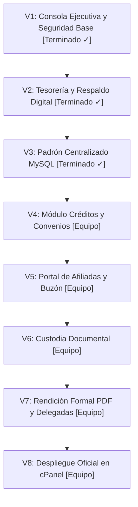

# SIGAV — Plan Maestro Unificado de Implementación y Gobernanza
### Sistema Integrado de Gestión Administrativa y Financiera
**Asociación Gremial de Trabajadores de Jardines Infantiles VTF — Temuco**

---

## 1. Contexto Institucional y Marco Estatutario

El **Sistema Integrado de Gestión Administrativa y Financiera (SIGAV)** es la plataforma oficial concebida para la gobernanza gremial, fiscalización contable, custodia documental, administración del padrón y rendición periódica de cuentas de los 23 jardines infantiles Vía Transferencia de Fondos (VTF) de Temuco y Labranza.

### Parámetros Operativos y Financieros Oficiales:
* **Cobertura Territorial:** 23 establecimientos educativos en Temuco y Labranza.
* **Padrón Representado:** 280 trabajadoras afiliadas (Directoras, Educadoras de Párvulos y Técnicos en Educación Parvularia).
* **Régimen Estatutario de Cuota Social:** Valor unificado de **$4.000 CLP mensuales** por afiliada activa:
  * **$1.000 CLP:** Aporte gremial ordinario a la Federación Nacional.
  * **$1.000 CLP:** Fondo operacional y de funcionamiento de la Asociación Local.
  * **$2.000 CLP:** Fondo de Bienestar y Evento Anual de Socias (Cena Anual).
* **Exención de Cobro:** Las socias con estado estatutario `SUSPENDIDA` quedan automáticamente exentas de la cuota social ($0 CLP).

---

## 2. Marco de Gobernanza, Roles y Privacidad (PoLP)

El sistema opera bajo el principio de **mínimo privilegio (PoLP)** y estricta **segregación de funciones**, garantizando la confidencialidad conforme a la Ley N° 19.628 sobre Protección de la Vida Privada:

| Nivel de Acceso | Perfil / Rol | Alcance Operativo | Perfil Financiero | Restricciones Estrictas |
| :--- | :--- | :--- | :--- | :--- |
| **Administración Técnica** | `ADMIN` / `SUPER_ADMIN` | Configuración, infraestructura, bitácora de auditoría y base de datos. | Supervisión contable técnica. | Sin autoasignación no auditada. |
| **Presidencia Gremial** | `PRESIDENTA` | Supervisión ejecutiva y representación institucional. | **Supervisión (Solo Lectura)**; consulta de balances y movimientos. | **Sin edición ni creación** de egresos. |
| **Tesorería General** | `TESORERA` | Emisión de egresos, recaudación de ingresos, conciliación y comprobantes. | **Gestión Total** de Tesorería. | Obligatoriedad de respaldo digital en egresos. |
| **Secretaría General** | `SECRETARIA` | Administración del Padrón (altas, bajas, suspensiones y traslados). | Sin acceso a finanzas operativas. | Bloqueo de libro contable. |
| **Dirección de Bienestar** | `DIRECTORA` | Consulta del padrón de su jardín y fiscalización de convenios sociales. | **Solo lectura de convenios** de su establecimiento. | **Bloqueo estricto de Tesorería general** y cuentas bancarias. |
| **Delegadas de Base** | `DELEGADA` | Representación de su establecimiento (23) ante la asamblea. | **Transparencia Institucional** (estadísticas agregadas de su jardín). | **Bloqueo estricto de deudas y saldos individuales**. |
| **Portal de Afiliadas** | `SOCIA` | Ficha personal, aportes individuales, consulta de noticias y buzón gremial. | Solo su propio estado y cuota. | Solo accede con su RUT personal. |

---

## 3. Arquitectura del Sistema

```text
dashboard/
├── backend/
│   ├── src/
│   │   ├── config/          # Pool MySQL (mysql2/promise) y variables de entorno seguras
│   │   ├── controllers/     # Controladores REST desacoplados por dominio
│   │   ├── middlewares/     # JWT, RBAC, auditoría forense, upload Multer y control primer ingreso
│   │   ├── routes/          # Enrutamiento API RESTful modular
│   │   ├── services/        # Servicios de dominio transaccionales (Tesorería, Socias, Créditos)
│   │   ├── utils/           # Validador oficial de RUT (Módulo 11) y helpers
│   │   ├── validators/      # Esquemas de integridad Zod
│   │   └── server.js        # Servidor Express, CORS estricto y middleware de errores
│   ├── database/            # DDL/DML saneados para importación cPanel/MySQL
│   ├── test/                # Suites de verificación automatizadas (auth, socias, comprobantes, treasury, portal)
│   └── uploads/             # Bóveda privada de comprobantes digitales (fuera de public_html)
├── frontend/
│   ├── src/
│   │   ├── components/      # Componentes UI (SIGAV Design System, modales, tablas)
│   │   ├── context/         # AuthContext, ThemeContext (modo oscuro HSL)
│   │   ├── pages/           # Vistas corporativas (Dashboard, Tesorería, Socias, Créditos, Portal)
│   │   ├── routes/          # Rutas protegidas por rol con React Router v6
│   │   ├── services/        # Clientes API Axios/Fetch con interceptores JWT
│   │   └── styles/          # Tokens HSL y estilos institucionales
│   ├── public/              # Isotipo y .htaccess para soporte SPA en Apache
│   └── vite.config.js       # Bundler Vite
└── docs/                    # Documentación, bitácora de desarrollo y tema SIGAV
```

---

## 4. Estado de Avance y Hoja de Ruta de Versiones

### Matriz de Seguimiento por Versiones

| Versión | Módulo / Hito | Responsable | Estado | Evidencia y Commits |
| :---: | :--- | :--- | :---: | :--- |
| **V1** | **Consola Ejecutiva, Directiva y Seguridad Base (PoLP)** | **Sebastian Olguín** | **Terminado ✓** | Commits `2a194fb`, `a768d64` (39 tests OK) |
| **V2** | **Tesorería Robusta y Respaldo Digital Obligatorio** | **Sebastian Olguín** | **Terminado ✓** | Commit `c3608ed` (46 tests OK) |
| **V3** | **Padrón Centralizado 100% Persistente en MySQL** | **Sebastian Victoriano** | **Terminado ✓** | 75 tests OK (`npm test`) |
| **V4** | **Módulo Independiente de Créditos y Convenios** | Carlos S. y Luis C. | **Pendiente (Equipo)** | Asignado para resolución del equipo |
| **V5** | **Portal de Afiliadas, Primer Ingreso y Buzón Gremial** | Sebastian A. y Braulio P. | **Pendiente (Equipo)** | Asignado para resolución del equipo |
| **V6** | **Custodia Documental y Carpeta por Proveedor** | Equipo Técnico | **Pendiente (Equipo)** | Asignado para resolución del equipo |
| **V7** | **Rendición Formal de Cuentas (PDF) y Portal Delegadas** | Equipo Técnico | **Pendiente (Equipo)** | Asignado para resolución del equipo |
| **V8** | **Validación Integral E2E y Despliegue Oficial en cPanel** | Equipo Completo | **Pendiente (Equipo)** | Asignado para resolución del equipo |



---

### Versión 1: Consola Ejecutiva, Directiva y Seguridad Base
> [!IMPORTANT]
> **Estado:** **Terminado ✓**  
> **Responsable:** Sebastian Olguín  
> **Commits:** `2a194fb`, `a768d64`  
> **Resultados Aprobados:** 12/12 pruebas de seguridad aprobadas (`npm run test:auth`).

#### 1. Archivos Remediados
- `database/database.sql`: Saneamiento DDL (remover `DROP DATABASE` y prefijos fijos incompatibles con cPanel). Agregada columna `estado ENUM('ACTIVA', 'SUSPENDIDA') DEFAULT 'ACTIVA'` en tabla `socias`.
- `database/admin.sql`: Hasheo bcrypt (costo 10) de cuentas operativas (`Admin123!` $\rightarrow$ `$2b$10$...`).
- `backend/src/config/env.js`: Validación estricta de variables de entorno y advertencia por `JWT_SECRET` por defecto.
- `backend/src/config/db.js`: Conexión determinística y comprobación de disponibilidad activa con inspección de códigos de error.
- `backend/src/services/authService.js`: Eliminación de comparación en texto plano, verificación de usuario `activo === 1` y resolución dinámica de alias de correo (`@vtf.cl` y `@asociacionvtf.cl`).
- `backend/src/middlewares/authMiddleware.js`: Verificación de vigencia y usuario activo en cada petición HTTP (403 Forbidden para usuarios inactivos).
- `backend/src/services/dashboardService.js`: Desacoplar saldos de Tesorería de `baseSummary` para no enviarlos a Directora, Delegadas ni Socias (Principio de Mínimo Privilegio).
- `backend/src/routes/treasuryRoutes.js`: Bloqueo estricto de rutas financieras a roles no autorizados (Directora rechazada con 403).
- `frontend/src/routes/AppRoutes.jsx` y `Sidebar.jsx`: Protección visual y de rutas para Tesorería.

---

### Versión 2: Tesorería Robusta y Respaldo Digital Obligatorio
> [!IMPORTANT]
> **Estado:** **Terminado ✓**  
> **Responsable:** Sebastian Olguín  
> **Commit:** `c3608ed`  
> **Resultados Aprobados:** 46/46 pruebas de backend aprobadas (`comprobantesTest.js` 11/11, `treasuryPersistenceTest.js` 4/4). Build Vite limpio en 7.63s.

#### 1. Archivos Remediados
- `database/database.sql` y MySQL: Nuevas columnas en `movimientos_tesoreria` (`comprobante_stored VARCHAR(255)`, `comprobante_mime VARCHAR(100)`, `comprobante_size INT`) y tipo modificado a `ENUM('INGRESO', 'EGRESO', 'SALDO_APERTURA')`.
- `database/data.sql`: Asientos oficiales de apertura contable de 2026: `MOV-2026-000A` ($5.103.000, Asociación) y `MOV-2026-000B` ($8.856.000, Cena Anual).
- `backend/src/validators/treasuryValidator.js`: Validación estricta Zod: montos forzados a números enteros en CLP (`.int()`), validación de fechas reales en calendario gregoriano (rechazando fechas inexistentes como el 30 de febrero) y centros de costo canónicos.
- `backend/src/services/treasuryService.js`:
  - **Correlativos Atómicos:** Sustitución de `COUNT(*) + 1` por consulta secuencial numérica con expresión regular (`MOV-YYYY-XXX`), eliminando colisiones bajo concurrencia.
  - **Persistencia de Archivos:** Inserción y lectura de `comprobante_stored`, `mime` y `size` en MySQL, garantizando la descarga de comprobantes tras el reinicio del servidor Node.
  - **Cálculo de Saldos sin Números Mágicos:** Suma dinámica basada en transacciones `SALDO_APERTURA`.
- `backend/src/controllers/treasuryController.js`: Descarga garantizada vía `storedName` desde el disco mediante la metadata persistida en base de datos.
- `frontend/src/pages/TreasuryPage.jsx`: Renderizado de insignia informativa (`.vtf-badge-info`) para transacciones de tipo `SALDO_APERTURA`.

---

### Hotfix 2026-11-09: Bloqueantes del despliegue en cPanel
> [!IMPORTANT]
> **Estado:** **Terminado ✓** (pendiente de aplicar en el hosting)  
> **Resultados:** 57 pruebas de backend aprobadas (`npm test`, incluye la nueva `test/bloqueantesTest.js`). Build Vite limpio.

#### 1. Bugs corregidos y causa
- **Producción corría sin base de datos y mostraba datos de prueba.** Las capturas mostraban "Jardín Rayito de Sol", que solo existe en `seedData.js`, el respaldo en memoria. La causa fue el nombre de usuario o de base sin el prefijo de cPanel (`vtftemuc_`), sumado a que nada esperaba la conexión inicial: las primeras peticiones del arranque en frío de Passenger se atendían en memoria. Ahora `db.js` espera el primer intento (`waitForDatabase`) y reintenta cada 15 s. En producción la API responde **503** en vez de usar datos de memoria (`ALLOW_MEMORY_FALLBACK`), y `/api/health` informa `database.conectada` junto con el código de error.
- **"No fue posible cargar las métricas":** era una consecuencia del punto anterior (sesión emitida en memoria y validada contra MySQL, o un timeout del arranque en frío). Ahora el dashboard muestra el motivo real y el timeout del cliente subió a 20 s.
- **Correos @vtftemuco.cl rechazados:** ahora el login acepta **solo** el correo exacto `@vtftemuco.cl` o el RUT (con o sin puntos). Se eliminaron los dominios `@vtf.cl` y `@asociacionvtf.cl` y los alias (`tesoreria@`, `alejandra.sias@`…).
- **La clave inicial de la socia seguía sirviendo después de cambiarla:** se eliminó esa excepción en `sociaAuthService.js`. Además, la nueva clave no puede ser la inicial.
- **RUTs ficticios de la directiva en `admin.sql`:** se reemplazaron por los del padrón y se cambiaron los correos a `@vtftemuco.cl`.
- **Misma clave para toda la directiva y sin cambio obligatorio:** se agregó la columna `administradores.primer_ingreso`, la ruta `POST /api/auth/cambiar-clave` con política mínima, un bloqueo en el servidor (403 `PASSWORD_CHANGE_REQUIRED`) y un modal bloqueante en el frontend. "¿Olvidó su contraseña?" ahora explica el procedimiento.
- `server.js` y `app.cjs` ahora incluyen los ajustes que antes existían solo en el paquete de despliegue (Passenger, mismo dominio, frontend en `public/`).

#### 2. Aplicación en el hosting
1. En la base ya instalada, ejecutar `database/migraciones/2026-11-09_directiva_y_primer_ingreso.sql`.
2. Corregir `DB_NAME` y `DB_USER` con el prefijo (ver `docs/GUIA_DESPLIEGUE_CPANEL.md`), subir el código nuevo y hacer Restart.
3. Comprobar que `https://vtftemuco.cl/api/health` responda `"conectada": true`.

---

### Versión 3: Padrón Centralizado 100% Persistente en MySQL
> [!IMPORTANT]
> **Estado:** **Terminado ✓** (pendiente de aplicar en el hosting)  
> **Responsable:** Sebastian Victoriano  
> **Resultados:** 75 pruebas de backend aprobadas en 7 suites (`npm test`, sobre la base de prueba `jardines_vtf_test`). Build Vite limpio. Lectura verificada con la planilla real "Maestra Socias": 277 filas, 0 errores.

#### 1. Decisiones de negocio
- **Cargos:** DIRECTORA, EDUCADORA, TECNICO, ASISTENTE, AUXILIAR y `SIN DATO` (22 socias del padrón real sin cargo, para completar).
- **Eliminar socia = baja lógica (`RETIRADA`)** con motivo y fecha. No cuenta ni cobra cuota, conserva créditos e historial y se reactiva editando su estado. El borrado físico de una socia con créditos queda bloqueado en la base (`ON DELETE RESTRICT`).
- **Planilla Maestra Socias:** vista previa y luego aplicación en una sola transacción. Las celdas vacías no borran datos. Las socias ausentes en la planilla **no** se dan de baja solas: se listan para revisión. Cada archivo se guarda en `uploads/padron/AAAA/MM/` sin sobrescribir y queda registrado en `cargas_padron`.
- **Se eliminó el padrón ficticio en memoria** (`sociasSeedData.js`). El portal de socias y el padrón trabajan solo con MySQL.

#### 2. Archivos
- `database/database.sql` y `data.sql`: tablas `jardines` (23), `historial_traslados` y `cargas_padron`. La socia pasa a `jardin_id` y suma `fecha_ingreso`, `es_delegada`, retiro y marcas de tiempo. Celulares en `+569XXXXXXXX` y correos en minúscula.
- `database/migraciones/2026-11-09_v3_padron_mysql.sql`: migración de bases ya instaladas.
- `backend/src/services/sociaService.js`: SQL parametrizado con paginación en el servidor, búsqueda por nombre, RUT (con o sin puntos), jardín o correo, y traslados transaccionales.
- `backend/src/services/padronImportService.js`, `utils/sociaFormat.js` y `validators/sociaValidator.js`.
- `frontend/src/pages/SociasPage.jsx` y `components/socias/*`: recuadros de la especificación, filtros (incluye "sin jardín" y "retiradas"), retiro con motivo, carga de Excel con vista previa y exportación completa según el filtro.
- `backend/test/run.js`: crea la base de prueba desde los SQL del repositorio y corre cada suite contra ella. Nunca toca la base de desarrollo.

#### 3. Bugs corregidos en el camino
- **Una socia suspendida conservaba el acceso al portal:** `getProfile` capturaba su propio error y devolvía un perfil genérico activo. Ahora también se exige el estado ACTIVA al iniciar sesión.
- **La bitácora nunca se guardaba en MySQL:** enviaba `admin-N` a la columna numérica `usuario_id`. Ahora guarda el número.
- **El Inicio mostraba números fijos del padrón** (280, 4 suspendidas, 98,6 %). Ahora se calculan con los datos reales.

#### 4. Criterios de Aceptación (verificados en `sociasTest.js` y `padronImportTest.js`)
- Crear una socia vía API, levantar un segundo backend y encontrarla en MySQL.
- Un traslado sin motivo falla con 400 sin alterar el jardín ni ningún otro dato (transacción).
- Una planilla aplicada dos veces no duplica ni cambia nada.

---

### Versión 4: Módulo Independiente de Créditos y Convenios Sociales
> [!NOTE]
> **Estado:** Pendiente — **Asignado para resolución del equipo** (Carlos S., Luis C.)  
> **Objetivo:** Diseñar el modelo relacional independiente y la lógica de negocio para las 4 empresas de convenio (`S.O.S`, `ISIMUNDO`, `OPTICA` y `DENTAL`), procesamiento de la planilla maestra mensual (día 18) y verificación de los 4 comprobantes bancarios (días 1-5).

#### 1. Archivos Involucrados
- `database/database.sql`: Tablas `convenios`, `creditos`, `cuotas_credito`, `cargas_mensuales` y `comprobantes_convenio`.
- `backend/src/routes/creditRoutes.js`: Endpoints `/api/creditos/...`.
- `backend/src/controllers/creditController.js`: Carga de planillas, consulta de estados y subida de comprobantes.
- `backend/src/services/creditService.js`: Reglas de conciliación, comisión 2% Isi Mundo y cálculo de última cuota.
- `frontend/src/pages/CreditosPage.jsx`: Interfaz de gestión con filtros por empresa, tabla de socias con crédito y vista de directiva.

---

### Versión 5: Portal de Afiliadas, Primer Ingreso y Buzón Gremial
> [!NOTE]
> **Estado:** Pendiente — **Asignado para resolución del equipo** (Sebastian A., Braulio P.)  
> **Objetivo:** Conectar el acceso de socias al padrón real de MySQL, aplicar el bloqueo obligatorio de primer ingreso hasta cambiar la clave inicial y estructurar el buzón con soporte de adjuntos.

#### 1. Archivos Involucrados
- `backend/src/services/sociaAuthService.js`: Sincronización 100% con la tabla `socias` de MySQL.
- `backend/src/middlewares/forcePasswordChangeMiddleware.js`: Interceptor de peticiones privadas si `primer_ingreso === 1`.
- `backend/src/services/buzonService.js`: Persistencia de mensajes y reclamos con clasificación y adjuntos en disco.
- `backend/src/services/noticiasService.js`: Publicación y consulta de avisos y comunicados oficiales.
- `frontend/src/pages/SociaPortalPage.jsx`: Portal responsivo de autoservicio con modal bloqueante de primer cambio de clave.

---

### Versión 6: Custodia Documental y Carpeta por Proveedor
> [!NOTE]
> **Estado:** Pendiente — **Asignado para resolución del equipo**  
> **Objetivo:** Repositorio centralizado de documentos institucionales, pagarés maestros y clasificación cronológica de convenios.

#### 1. Archivos Involucrados
- `database/database.sql`: Tabla `documentos_institucionales`.
- `backend/src/routes/documentRoutes.js` y `documentController.js`.
- `frontend/src/pages/DocumentosPage.jsx`: Árbol de carpetas cronológicas por empresa (`año / mes / día`) y descargas de pagarés tipo.

---

### Versión 7: Rendición Formal de Cuentas (PDF) y Portal Delegadas
> [!NOTE]
> **Estado:** Pendiente — **Asignado para resolución del equipo**  
> **Objetivo:** Habilitar la consola exclusiva para las 23 delegadas con cifras consolidadas y generación automática del Balance Anual en PDF para asambleas.

#### 1. Archivos Involucrados
- `backend/src/services/reportService.js`: Motor de generación de reportes y balances en PDF.
- `frontend/src/pages/ReportesPage.jsx`: Consola de fiscalización para Delegadas (sin acceso a deudas individuales).

---

### Versión 8: Validación Integral E2E y Despliegue Oficial en cPanel
> [!NOTE]
> **Estado:** Pendiente — **Asignado para resolución del equipo completo**  
> **Objetivo:** Certificar la plataforma completa sin errores, verificar el paso del 100% de tests unitarios/E2E y ejecutar el despliegue limpio en cPanel / LiteSpeed.

#### 1. Archivos Involucrados
- `backend/package.json` y `frontend/package.json`: Depuración de dependencias obsoletas.
- `GUIA_DESPLIEGUE_CPANEL.md`: Procedimiento de puesta en marcha en hosting de producción (INA Networks).
- `.htaccess`: Soporte nativo de React Router en Apache sin errores 404 al recargar.

---

## 5. Tabla de Parámetros y Decisiones de Negocio Aprobadas

| N° | Tema / Parámetro | Definición Oficial de Negocio |
| :--- | :--- | :--- |
| **D1** | **Directora en Créditos** | La Directora puede fiscalizar convenios y créditos vigentes de su jardín, pero tiene **bloqueado el acceso a la Tesorería general**. |
| **D2** | **Acceso Delegadas** | Las Delegadas acceden únicamente a estadísticas agregadas de su establecimiento y rendición formal; **nunca ven deudas individuales**. |
| **D3** | **Políticas de Claves** | Contraseña inicial: primeros 6 dígitos del cuerpo del RUT. Cambio obligatorio al primer ingreso para desbloquear el sistema. |
| **D4** | **Créditos Pagados** | Se muestran con estado `PAGADO` durante el mes de cierre y al mes siguiente se archivan en la vista histórica. |
| **D5** | **Saldos Iniciales** | Se registran como asientos contables formales de tipo `SALDO_APERTURA` fechados al inicio del ejercicio contable (01/01/2026). |
